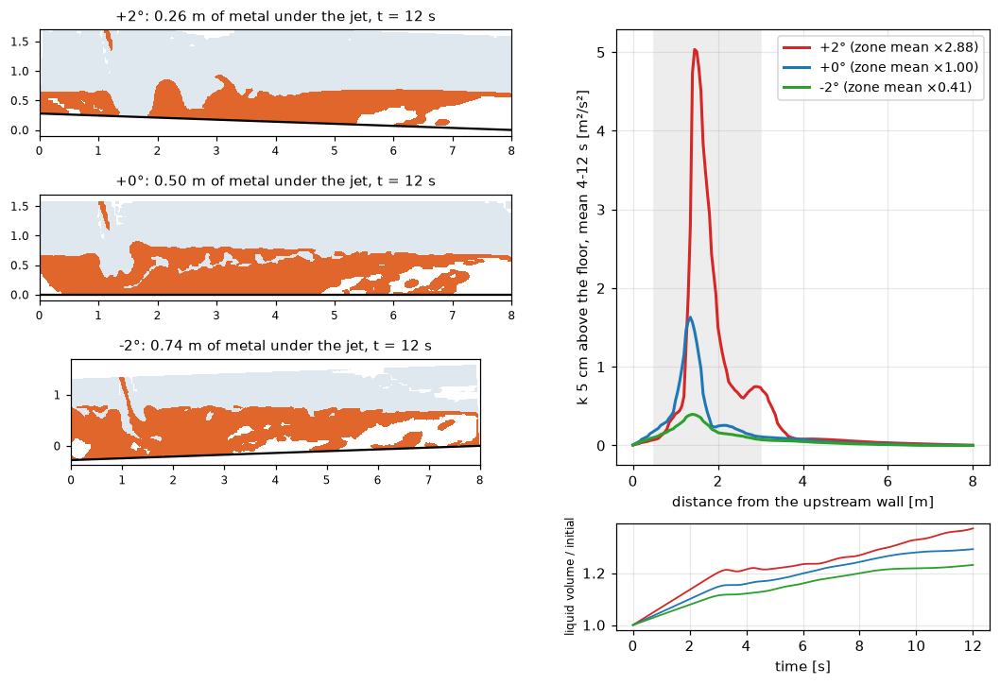

# Free-surface flow: runners, channels, launders

`pp.cfd.FreeSurfaceFlow` (`pinneapple_simulation.numerical_solvers.free_surface`) writes and runs OpenFOAM
`interFoam` cases with two phases separated by a free surface (volume of fluid). It covers:

- melt runners and launders;
- spillways and open channels;
- tanks filled by a jet.

```python
from pinneapple_simulation.numerical_solvers.free_surface import FreeSurfaceFlow, Phase, SampleLine

flow = FreeSurfaceFlow(
    mesh="cases/runner/mesh",                                   # or regions={name: (V, F)} for snappyHexMesh
    roles={"jet": "inlet", "top": "atmosphere", "exit": "outlet"},       # every other patch is a wall
    inlet_velocity={"jet": (0.0, 9.85, 1.74)},                  # the full vector, m/s
    level=-2.04,                                                 # initial liquid level, height along -gravity
    liquid=Phase("metal", rho=7200, nu=8.472e-6), gas=Phase("air", rho=1.2, nu=1.5e-5), sigma=1.8,
    gravity=(0, 0, -9.8), end_time=30.0, sample_every=0.1, keep_every=1.0,
    lines=[SampleLine("L1", (-1.8, -7.429, -2.2), (-1.8, 15.305, -2.2), 101)])
flow.write("cases/runner/run", procs=4)
flow.run("cases/runner/run", procs=4)                           # setFields, decomposePar, interFoam
prof = flow.profiles("cases/runner/run", t_start=2.0)["L1"]    # times x points, and the time mean
```

## Boundary conditions

| Role | Velocity | Liquid fraction | Pressure | k, ω |
|---|---|---|---|---|
| inlet | the given vector | 1 | fixed flux | from intensity (1 %) and mixing length (0.1 m) |
| outlet, atmosphere | pressure inlet-outlet | inlet-outlet; reverse flow is gas | total pressure `p_ref` (prghTotalPressure) | inlet-outlet |
| wall | no slip | zero gradient | fixed flux | wall functions |

**Initial state.** The liquid fills everything below `level`. `level` is a height along −gravity, so gravity may be
tilted, as for a sloped channel meshed in its own frame. `hRef` is set at the level, so the initial hydrostatic
state is in balance. The turbulence model is k-ω SST, or laminar.

## Lines sampled while the solver runs

`LiveLineSampler` reads each time the solver writes and records the nearest cell's value at every point of every
line. There is no spatial interpolation, and points outside the fluid are dropped. It then writes
`postProcessing/lines/<t>/<line>.csv`.

- **No function objects.** It does not use OpenFOAM function objects. Their `sets` and `probes` types abort in
  parallel on OpenFOAM v1912.
- **Bounded disk.** With `keep_every`, the times it has sampled are deleted, except one every `keep_every` seconds
  and the last. This bounds the disk use of a long transient. In a 30 s run of 180 000 cells, the 300 field writes
  would otherwise take more than 10 GB.
- **Serial and decomposed cases.** It reads both. It also takes a callable instead of a directory, for runners that
  retry in new directories.


## Example: floor slope of a melt runner



`examples/free_surface/01_runner_slope_study.py` uses `TroughSection`
(`pinneapple_design.geometry.trough`): a 2-D section of an 8 m runner with a 0.5 m weir at the downstream end.

**Setup.**
- A jet enters through an 8 cm slot and reaches the bath at about 5 m/s.
- The floor pivots about the weir end, so only the depth under the jet changes: 0.26 m at +2° (floor descending
  toward the weir), 0.50 m at 0° and 0.74 m at −2°.
- The mesh is rectangular in the runner's frame, and the slope enters through tilted gravity. A sloped mesh with
  vertical gravity diverged in the shallow upstream corner. The tests check that the tilted frame keeps the weir
  crest, the bath level and the vertical jet speed.

**Results.** k is taken 5 cm above the floor and averaged over 4–12 s:

| Slope | Metal under the jet | Mean k, impact zone 0.5–3 m | Relative to 0° | Peak k |
|---|---|---|---|---|
| +2° | 0.26 m | 1.40 m²/s² | ×2.9 | 5.0 m²/s² |
| 0° | 0.50 m | 0.49 m²/s² | ×1 | 1.6 m²/s² |
| −2° | 0.74 m | 0.20 m²/s² | ×0.41 | 0.40 m²/s² |

A deep pool at impact damps the jet before it reaches the floor, and a shallow one lets it hit the floor almost
undamped. The ranking is clear.

The magnitudes are for screening only:
- the section is 2-D, so a slot replaces the round jet;
- the turbulence model is RANS with wall functions, on 4 cm cells;
- after 12 s the bath is still filling, about 25–35 % more liquid than at the start.

The study ranks the slopes but does not give a wear rate.

Tests: `tests/test_free_surface.py`. They check the region split, the tilted frame, the written case (patch roles,
the empty front and back skipped, inlet k from the intensity, a rotated box for setFields, `hRef`), and a short
OpenFOAM run that keeps the floor line in the bath and deletes the sampled times.
