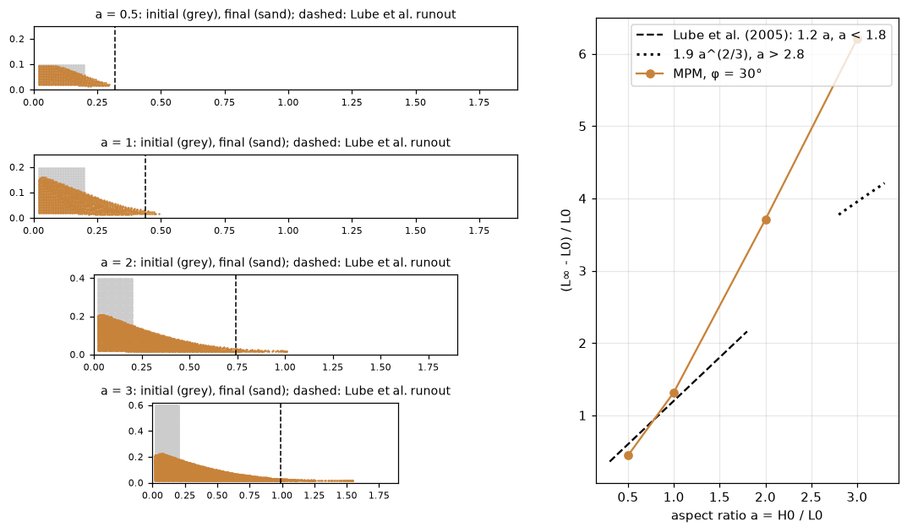
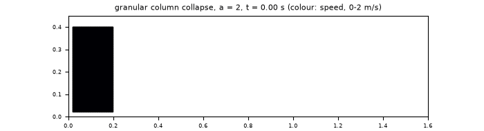

# Geomechanics with the material point method

`pinneapple_simulation.particle_dynamics.geo_mpm` simulates granular flows, landslides, dam breaks and soft bodies
with the material point method (MPM), in physical units, in 2-D or 3-D. It is written in PyTorch from the
published algorithms:
- MLS-MPM with APIC transfer, Hu et al. (2018);
- Drucker–Prager return mapping in Hencky strain, Klár et al. (2016).

| Material | Model |
|---|---|
| `Sand(friction_deg, E, nu, rho)` | Cohesionless Drucker–Prager without dilation. In 2-D the default is plane strain: the out-of-plane elastic stretch is tracked, so the total out-of-plane strain stays zero, as in a laboratory flume, and the cone is matched to Mohr–Coulomb in plane strain. In 3-D it is matched in triaxial compression |
| `Fluid(K, rho, gamma)` | Weakly compressible fluid: pressure from J (Tait-like), no shear memory |
| `Elastic(E, nu, rho)` | Fixed-corotated hyperelastic solid |

**Boundaries.** The walls are the faces of the domain: `"slip"`, `"sticky"`, or `"friction"` with a Coulomb
coefficient.

**Bodies.** Each body is seeded with `ppc` particles per cell along each axis. A run can hold several bodies of
different materials.

**Output.** Frames are written in GeoTaichi's layout (`<out>/particles/MPMParticle<NNNNNN>.npz`, with `position`,
`velocity`, `volume`, `stress` and `body`).

```python
from pinneapple_simulation.particle_dynamics.geo_mpm import GeoMPM, Sand, box, runout
sim = GeoMPM(domain=(1.4, 0.3), dx=0.01, floor="sticky", walls="slip")
sim.add_body(box((0, 0), (0.2, 0.2)), Sand(friction_deg=30.0))
frames = sim.run(t_end=1.0, save_every=0.05, out="runs/collapse")
runout(frames[-1]["position"])
```

## GeoTaichi

[GeoTaichi](https://github.com/Yihao-Shi/GeoTaichi) (Zhejiang University, GPL-3.0) is a much larger Taichi
framework. It covers:
- MPM, including two-phase porous media and incompressible fluids;
- DEM and level-set DEM, affine bodies;
- FEM and IGA;
- MPM–DEM, FEM–MPM and IGA–MPM couplings, with incremental potential contact.

`pinneapple_simulation.external_solvers.geotaichi` uses it as an external program. PINNeAPPle never imports or ships
its code:
- `run_geotaichi(script, workdir)` runs one of its scripts in a separate process, with `GEOTAICHI_HOME` pointing at a
  checkout.
- `read_geotaichi(path)` reads the MPM or DEM particle frames. Pickled entries are skipped unless
  `allow_pickle=True`, which should be used only for files you trust.
- `frames_to_samples(frames)` turns them into `PhysicalSample`s, the format the rest of the library trains on.

`read_geotaichi` also reads `geo_mpm` frames, so a GeoTaichi run and a PINNeAPPle run of the same problem can be
compared directly. The GeoTaichi features not yet in `geo_mpm` are listed in issue #471: μ(I) rheology, porous
media, DEM coupling, GPU, and a learned simulator on MPM data.

## Example: granular column collapse





`examples/geomechanics/01_granular_column_collapse.py` collapses sand columns with φ = 30°, width L0 = 0.2 m and
aspect ratios a = H0/L0 of 0.5 to 3. Each column stands against a back wall, on a rough floor, with 1 cm cells. The
runout is compared with the fits Lube et al. (2005) measured in two-dimensional collapses:
(L∞ − L0)/L0 = 1.2 a for a < 1.8, and 1.9 a^(2/3) for a > 2.8.

| a | MPM (L∞ − L0)/L0 | Lube et al. (2005) | MPM / experiment | Final height / L0 |
|---|---|---|---|---|
| 0.5 | 0.44 | 0.60 | 0.73 | 0.47 (H0 = 0.5) |
| 1 | 1.32 | 1.20 | 1.10 | 0.77 |
| 2 | 3.71 | 2.4–3.0 (transition) | 1.2–1.5 | 1.03 |
| 3 | 6.20 | 3.95 | 1.57 | 1.07 |

**Agreement.** The deposits come to rest (final speeds of a few mm/s). For a ≤ 1 the runout is within about 27 %
of the experiments, and the short column keeps its top: final height close to H0 for a = 0.5, as observed.

**Limit.** Tall columns run out too far, and the 2/3 power regime is not reproduced. This is the known limit of
rate-independent plasticity, which has no rate- or inertia-dependent friction. The μ(I) rheology that captures it
is the first item of issue #471.

**Choosing the yield cone.** The cone matching matters as much as φ. Measured on the same columns (a = 0.5, 1
and 2):
- with pure 2-D strains (no plane-strain constraint) and the triaxial cone, the runout was 4–10 % longer than with
  the default;
- with plane strain but the triaxial-compression cone, it was 36–48 % shorter.

Tests: `tests/test_geo_mpm.py` checks:
- free fall of an elastic block at g, mass conserved;
- a hydrostatic pressure gradient of ρg within 5 % (fit over 0.1–0.4 s, while the weakly compressible column
  oscillates);
- a sand column that spreads within bounds and comes to rest;
- the frame reader on GeoTaichi-style files, pickled entries included.
