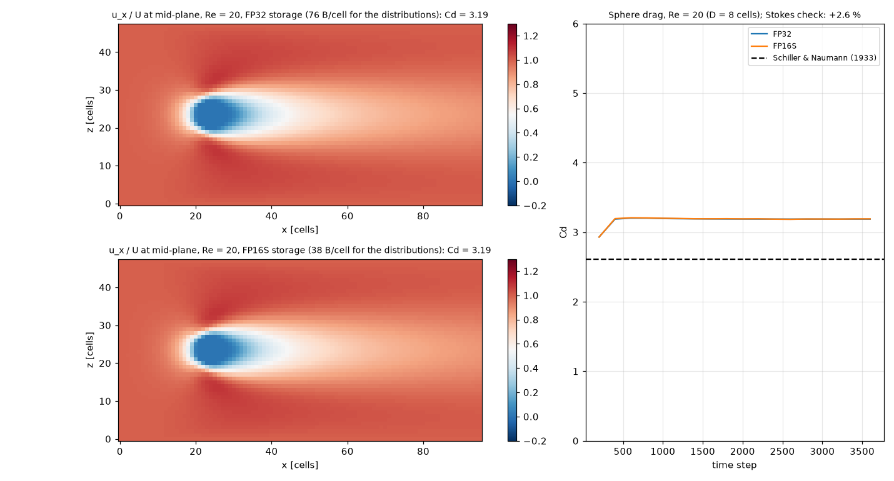

# Lattice Boltzmann wind tunnel and the FluidX3D bridge

Two pieces, both under `pinneapple_simulation`:

| Module | What it is |
|---|---|
| `numerical_solvers.lbm_tunnel` | A 3-D lattice Boltzmann solver written in PyTorch (CPU or GPU) for wind-tunnel cases: inlet, outlet, open sides, walls, moving walls, solid bodies from masks or STL files, and the force on them. |
| `external_solvers.fluidx3d` | A bridge to [FluidX3D](https://github.com/ProjectPhysX/FluidX3D) (Moritz Lehmann's OpenCL LBM for GPUs): it writes a wind-tunnel `main_setup()` into your own FluidX3D checkout, builds and runs it, and reads back forces and `.vtk` fields. |

The solver uses methods from the LBM literature that FluidX3D also uses. No FluidX3D code is copied or shipped:

- D3Q19 and D3Q27 velocity sets;
- SRT or TRT collision (TRT magic parameter 3/16), with optional Smagorinsky LES (Hou et al. 1996);
- DDF shifting: the solver stores f − w instead of f, which keeps the 16-bit rounding error small (Lehmann et al. 2022);
- FP16 storage (`storage="fp16s"`), which halves the memory of the distributions;
- Guo forcing, split into its even and odd parts so that it is correct with TRT;
- halfway bounce-back on solids, with the moving-wall term;
- momentum-exchange force on bodies;
- equilibrium inlet and open faces, and a zero-gradient outlet;
- unit conversion between lattice units and SI (`Units`);
- legacy VTK output that ParaView reads, and that FluidX3D's own exports share.

## Quick start

```python
from pinneapple_simulation.numerical_solvers.lbm_tunnel import WindTunnelLBM, Units, sphere

un = Units.from_si(lbm_length=8, lbm_velocity=0.05, lbm_rho=1,      # D = 2 cm sphere at 0.1 m/s
                   si_length=0.02, si_velocity=0.1, si_rho=1260)  # in a glycerol-water mix
lbm = WindTunnelLBM((96, 48, 48), nu=un.nu(1e-4), u_in=(0.05, 0, 0), storage="fp16s")
lbm.add_solid(sphere(lbm.shape, (24, 23.5, 23.5), 4))
lbm.run(3000)
Fx = un.si_F(lbm.force_on_solid()[0])          # drag in newtons
lbm.write_vtk("out/sphere")                     # sphere-u.vtk, sphere-rho.vtk, sphere-flags.vtk
```

Faces are set per side with `faces={"x-": "inlet", "x+": "outlet", "y-": "open", ...}`. Each side is one of `inlet`,
`outlet`, `open`, `wall`, `moving` or `periodic`. The defaults are an inlet at x−, an outlet at x+, and open on the
other four sides. `voxelize_stl(trimesh_mesh, shape, center, size)` turns an STL into a solid mask.

## Validation

`examples/lbm/01_sphere_wind_tunnel.py` runs these cases (tests in `tests/test_lbm_tunnel.py`):

| Case | Result |
|---|---|
| Force-driven Poiseuille channel, SRT and TRT | < 1 % from the parabola |
| Stokes drag on a sphere (Re ≈ 0.1), Stokes far field on the sides | R = 5 cells: +2.6 %; R = 8 cells: +1.1 % against 6πρνRU |
| Sphere at Re = 20, D = 8 cells, 96 × 48 × 48 tunnel, FP32 | Cd = 3.19; Schiller & Naumann (1933) gives 2.61 (+22 %) |
| Same, FP16 storage, half the memory (38 instead of 76 B/cell) | Cd = 3.19, 0.05 % from FP32; velocity differs by at most 0.002 U |



The Re = 20 drag is 22 % above the correlation for two reasons. The sphere is only 8 cells across, so its surface is a
staircase. The tunnel is only 6 diameters wide, and the open sides hold the free-stream velocity, which confines the
flow; at low Re the disturbance reaches far, so this matters. The Stokes case shows the method converges with resolution
(+2.6 % at R = 5, +1.1 % at R = 8). For numbers you report, use bodies of 20+ cells and a tunnel 15+ diameters wide.
The example is sized to run in about an hour on 4 CPU cores. FP16 storage works when the flow moves at u ≳ 0.02 in lattice units. Far below that (u ≈ 0.005),
the 16-bit rounding is a few percent of the velocity.

## FluidX3D bridge

```python
from pinneapple_simulation.external_solvers.fluidx3d import WindTunnelSetup, run_fluidx3d, read_results, results_to_samples

s = WindTunnelSetup(stl="stl/car.stl", length_m=4.5, velocity_m_s=30, nu_m2_s=1.5e-5, rho_kg_m3=1.2,
                    box=(1.0, 3.0, 0.75), memory_mb=2000, time_s=0.5, export_every_s=0.1, floor=True)
run_fluidx3d(s)                          # needs FLUIDX3D_HOME and an OpenCL device
res = read_results()                     # res["forces"]: (t, Fx, Fy, Fz) in N; res["fields"]["u"]["data"]
samples = results_to_samples(res)        # PhysicalSamples for training
```

`write_setup` backs up `src/setup.cpp` to `setup.cpp.pinneapple.bak` and replaces the active `main_setup()`.
`enable_features` switches on the `defines.hpp` extensions the setup needs (`EQUILIBRIUM_BOUNDARIES`, `FORCE_FIELD`,
`VOLUME_FORCE`, `SUBGRID`, `MOVING_BOUNDARIES` for a moving floor, `FP16S`) and comments out `BENCHMARK`. The generated setup uses only the API in FluidX3D's documentation.
It has not been compiled against every FluidX3D version, so check the build log the first time.

**License.** FluidX3D is not open source in the OSI sense: its [license](https://github.com/ProjectPhysX/FluidX3D/blob/master/LICENSE.md)
allows public research, education and personal use, and forbids commercial and military use. PINNeAPPle does not
download or bundle it. You clone it yourself and are responsible for using it within those terms. The PyTorch solver
above is independent of FluidX3D and is covered by PINNeAPPle's own license.

## Not implemented yet

The FluidX3D features this solver does not have yet are tracked in issue #473:

- free surface (VOF-LBM);
- esoteric-pull in-place streaming;
- D2Q9 and D3Q15;
- temperature;
- particles and IBM;
- multi-GPU domains;
- ray-traced graphics.
