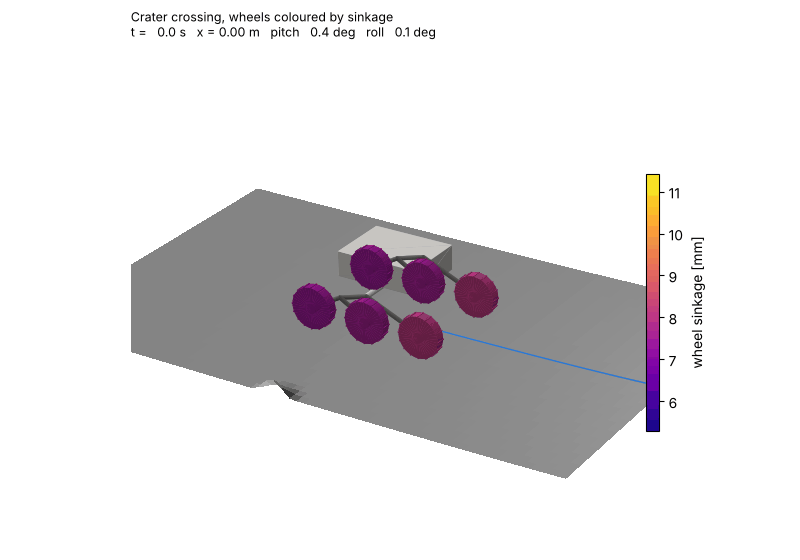
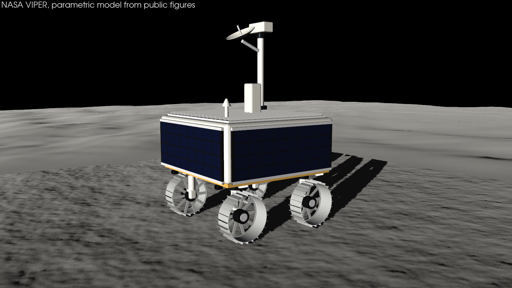
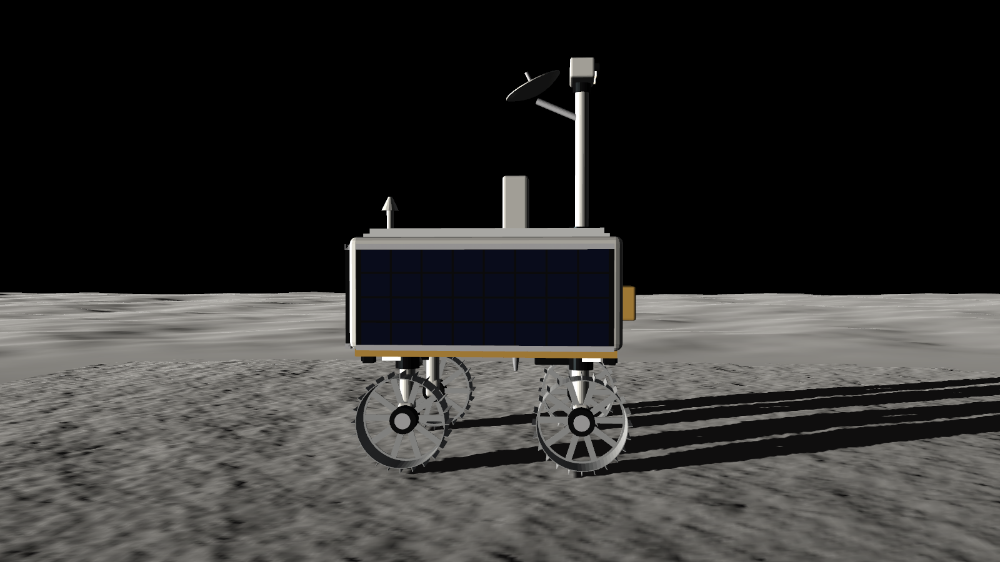
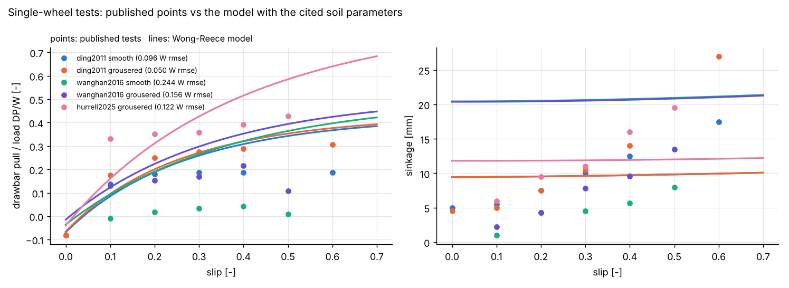
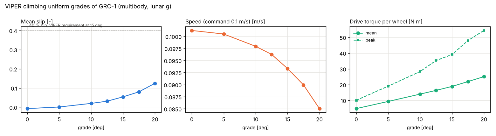
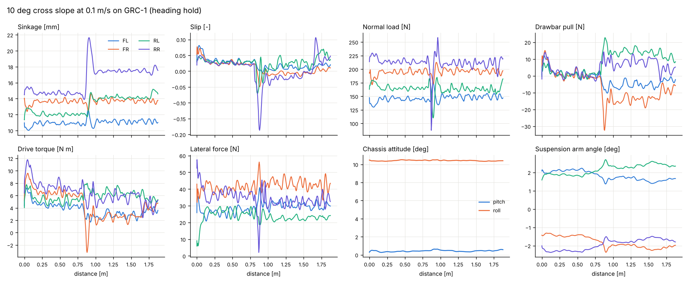
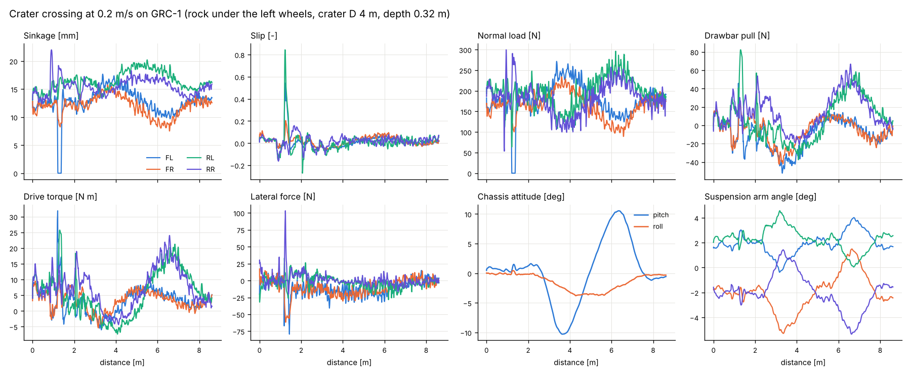
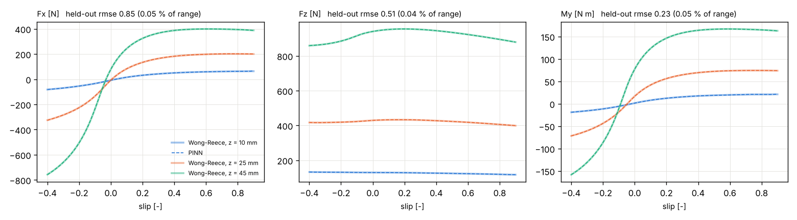

# Lunar rover terramechanics in 3D

[](https://colab.research.google.com/github/PINNeAPPle-Labs/PINNeAPPle/blob/main/notebooks/colab/04_lunar_rover_dashboard.ipynb)

NASA's VIPER rover at real scale, driving on lunar regolith with Wong-Reece wheels and full multibody dynamics.
Everything on this page is a library feature: the soil database, the wheel model, the deformable terrain, the
multibody vehicle, the CAD, the renders and the PINN surrogate. The example
`examples/use_cases/terramechanics/lunar_rover_3d.py` is a thin script that puts them together.



```python
import pinneapple as pp
from pinneapple_simulation.vehicle import scenarios, viz

spec = pp.vehicle.viper()                                   # cited figures in spec.sources, CAD in spec.cad
spec.cad.export("viper.glb")                                # PBR materials; .stl too
site = scenarios.crater_site()                              # deformable regolith, a crater, rocks
run = pp.vehicle.VehicleSimulator(pp.vehicle.build_vehicle(spec), site,
                                  pp.terramechanics.get_soil("GRC-1")).run(45.0, speed=0.2)
run.summary()                                               # distance, slip, sinkage, energy, loads, attitude
viz.animate(run, site, "run.gif", mp4="run.mp4", field="normal_stress")
```

| Library module | What it holds |
|---|---|
| `pinneapple_simulation.terramechanics.soils` | `Soil`, `get_soil`: GRC-1, JSC-1A and the validation soils, each parameter with its source |
| `pinneapple_simulation.terramechanics.wong_reece` | `WongReeceModel`: stresses on the contact arc, forces, sinkage for a load, testbed operating points |
| `pinneapple_simulation.terramechanics.terrain` | `DeformableTerrain` (soil memory, ruts, grouser marks, stress maps), `RigidRock` |
| `pinneapple_simulation.terramechanics.testbed` | single-wheel testbed, the bundled published points, validation and (separate) calibration |
| `pinneapple_simulation.terramechanics.surrogate` | `train_contact_surrogate`: PINN of the wheel-soil contact with a held-out error report |
| `pinneapple_simulation.multibody` | `MultibodyTree`: floating base, revolute joints, linearly implicit steps |
| `pinneapple_simulation.vehicle` | `VehicleSpec`, `build_vehicle`, `VehicleSimulator`, `viper()`, `scenarios`, `viz` |
| `pinneapple_design.geometry.vehicle_cad` | parametric vehicle CAD, centre of mass and inertia from the meshes, glTF/STL |
| `pinneapple_tools.visualization.studio` | `lighting` presets, `shadows` (Sun shadows, Lunar-Lambert), `planetary` renders |

Shortcuts: `pp.terramechanics`, `pp.multibody`, `pp.vehicle`.

## About the sources

Every number below either cites a source or is marked as an estimate with its reason. One caveat applies to all
of them. From the environment this was built in, NASA's documents and the journal papers could only be found
through a web search. The search returned text excerpts, but the PDFs, figures and photos could not be opened. So:

- the wording of the quotes, and the slide or page they come from, should be checked against the documents;
- the single-wheel test points are third-party readings of the published figures (see Validation), not tables
  from the papers;
- the renders were compared with VIPER's published dimensions and ratios, not with photographs, because the
  photographs could not be downloaded. A side-by-side check against the NASA photo pages listed below is still
  to do.

## The rover: NASA VIPER




| Quantity | Value used | Source |
|---|---|---|
| Envelope (L × W × H) | 1.7 × 1.7 × 2.5 m (model: 1.63 × 1.65 × 2.50 m) | Bluethmann (2024), *VIPER Rover Overview and Mobility and Hardware*, LSIC, NTRS 20240013903 |
| Mass | 450 kg (447 kg roving in LSIC 2024) | Francis & Sobey (2025), *Design and Test of the VIPER Mobility Actuators*, NTRS 20250000568 |
| Wheels | 4, 0.50 m diameter, 0.20 m wide, rigid sheet metal with spokes and rim grousers | Fong, VIPER briefings, NTRS 20220000441 and 20250004148 |
| Grousers | 24, 0.025 m tall | Hu et al. (2025), J. Field Robotics, doi:10.1002/rob.22597 (arXiv:2405.11001); 2.5 cm also in LSIC 2024 |
| Mobility module per corner | actuated suspension, steering and drive | Francis & Sobey (2025) |
| Suspension | ±40°, 200 N m | Fong (2022, 2025) |
| Steering | ±50° | McBryan, Francis & Sobey (2025), ICES-2025-147, NTRS 20250005201 |
| Track, wheelbase | ≈ 1.3 m, ≈ 1 m at nominal ride height; suspension changes ride height and track, steering changes track and wheelbase | *Investigating the geotechnical properties of the lunar south pole with NASA VIPER's mobility system*, Planet. Sci. J. (2025), doi:10.3847/PSJ/add13f |
| Speed | 0.20 m/s top, 0.10 m/s prospecting | Fong (2022), NTRS 20220000441 |
| Mast | tip ≈ 2.5 m above the wheel rims; NavCam pair and LED headlights on a pan-tilt head | NASA (2023), *VIPER team raises its mighty mast* |
| Antennas | gimballed high-gain (gimbal at ≈ 2.3 m), fixed low-gain | LSIC 2024 |
| Power and thermal | solar arrays on three sides, radiator on top | LSIC 2024; Fong (2022) |
| Drill | TRIDENT, 1 m class, vertical, in the middle of the rover | Zacny et al. (2021), LPSC 52, abstract 2400 |
| Instruments | NSS on the front; NIRVSS and MSolo under the rover; one hazard camera per wheel | Andrews (2020), NTRS 20205000864; Fong (2022) |

**Estimates** (not found in the sources that could be reached). Each one is chosen to agree with the published
envelope, track, wheelbase and wheel size:

- **Suspension geometry:** pivots under the chassis, arm length, and a 0.15 m steering offset. These give the
  1.3 m track and 1.0 m wheelbase, and ±40° of arm travel changes ride height and track as the PSJ paper says.
- **Chassis:** a closed 1.50 × 1.56 × 0.66 m box with its belly 0.64 m above the ground. With the arrays flush on
  its sides it fills the 1.7 m envelope, and the wheels stay clear under the belly when steered ±50°.
- **Other dimensions:** array panels covering the body faces (1.40 × 0.58 m on the sides, 1.46 × 0.58 m aft); high-gain dish 0.40 m across; straight grousers (the shape was
  not found).
- **Mass split:** per corner, 12 kg wheel with its drive, 8 kg steering module and 10 kg arm; 330 kg chassis,
  split among structure, avionics, arrays, radiator, mast, drill and instruments. The centre of mass and the
  inertias are computed from the CAD meshes with these masses.
- **Actuators:** drive torque limit 80 N m (more than the soil torque at 90 % slip under the static lunar load,
  so traction, not the motor, limits climbing); wheel speed limit 2.5 rad/s; steering torque limit 60 N m.

All of this lives in `pinneapple_simulation.vehicle.viper.VIPER_SOURCES`. The CAD is built by
`pinneapple_design.geometry.vehicle_cad`:
- every part is a closed mesh with a material and a mass;
- the bodies (chassis, 4 arms, 4 steering modules, 4 wheels) get their mass, centre of mass and inertia tensor from
  the meshes (Eberly's polyhedral mass properties, checked against boxes, cylinders and tubes in the tests);
- `export(".glb")` writes glTF with PBR materials (new studio materials: white paint, anodised black, wheel metal,
  solar cells, radiator, gold and silver MLI, lens, LED, regolith, rock).

Computed for the model: total mass 450.0 kg, centre of mass 0.859 m above the ground at nominal ride height, and
principal inertias about it 169 / 169 / 173 (roll / pitch / yaw) kg m² (glTF: [viper.glb](../assets/lunar_rover/viper.glb)).

## Wheel-soil model

`WongReeceModel(soil, wheel, g=1.62)` integrates the stresses on the contact arc with piecewise Gauss-Legendre
quadrature, vectorised over wheels.

- **Normal stress:** Bekker pressure-sinkage `σ = (k_c/b + k_φ) h^n`, with the Wong-Reece shape: maximum at
  `θ_m = (a0 + a1 s) θ_f`, and the rear arc mapped onto the front one (Wong & Reece 1967; Wong 2008).
- **Shear:** Janosi-Hanamoto `τ = (c + σ tan φ)(1 - e^(-j/K))`, with the shear displacement
  `j = R_s[(θ_f - θ) - (1 - s)(sin θ_f - sin θ)]`.
- **Slip-sinkage:** the exponent grows with slip, `n = n0 + n1|s|` (Ding et al. 2011).
- **Grousers:** shear on the equivalent radius `R_s = R + λ h` (Ding et al. 2011, λ = 1 by default). The visual
  grouser marks come from the vehicle simulation (below).
- **Multi-pass:** Wong's repetitive loading. The soil remembers the deepest sinkage it carried, `z_u`. A later wheel
  reloads it elastically (`p = k_u h`, `k_u = k_u0 + A_u z_u`) up to `p_u = k z_u^n`, then follows the virgin
  curve. As in Wong's treatment of consecutive wheels in one track, the shear displacement left by the wheel in
  front is carried over. A rear wheel in a rut therefore sinks deeper in total but needs less extra compaction,
  and its traction builds over a shorter arc. Both effects are tested.
- **Bulldozing:** passive earth pressure on the soil wedge, `R_b = b(0.67 c z K_pc + 0.5 z² γ K_pγ)`, with
  Terzaghi's bearing-capacity factors (Bekker 1969; Wong 2008). It is applied on the side face by default. Ahead
  of the wheel it is optional (`bulldozing="both"`), because Wong-Reece's `σ sin θ` term already contains the
  compaction resistance.
- **Lateral force and side slip:** lateral shear with `j_y = R(1 - s)(θ_f - θ) tan β` (Ishigami et al. 2007), plus
  sidewall bulldozing. The force opposes the side slip.

The model reproduces the library's earlier Bekker-Wong solver to 2e-6 relative error when the extensions are off.

### Soils

`get_soil(name)` returns the parameters with `soil.sources` (and `soil.provenance()` as a table). Status of each
parameter:

| Soil | c [kPa] | φ [°] | k_c [kN/m^(n+1)] | k_φ [kN/m^(n+2)] | n | ρ [kg/m³] | K [m] | Status |
|---|---|---|---|---|---|---|---|---|
| GRC-1 | 0.25 | 38 | 0.7 | 505 | 0.8 | 1620 | 0.018 | c, φ, k_c, k_φ, n, ρ: secondary (the RoverDevKit catalogue, MIT, which attributes them to Oravec et al. 2010); K: estimate |
| JSC-1A | 1.0 | 45 | 1.4 | 820 | 1.0 | 1600 | 0.018 | secondary (RoverDevKit, attributed to Zeng et al. 2010). k_c, k_φ, n equal the classic Apollo lunar-soil set, so they are probably not a JSC-1A bevameter fit; K: estimate |
| Ding2011-TYII | 0.25 | 31.9 | 15.6 | 2407.4 | 1.10 | 1605 | 0.011 | secondary (Ding et al. 2011, Table 2, via RoverDevKit) |
| FJS-1/Hurrell2025 | 2.4 | 38 | 1.37 | 820 | 1.0 | 1740 | 0.018 | c, φ secondary (Hurrell et al. 2025); pressure-sinkage proxied by catalogue FJS-1 |
| KLS-1 | 1.716 | 40.6 | −44.06 | 3581.8 | 1.26 | 1600 | 0.018 | secondary (Wang & Han 2016; Lim et al. 2021) |

Other values, not measured for these simulants:
- **Wong-Reece coefficients:** a0 = 0.40, a1 = 0.15, exit-angle ratio 1/3 (estimates, the library's earlier
  values).
- **Unloading modulus:** k_u0 = 2e8 N/m³. Almost all of the sinkage stays plastic.
- **Slip-sinkage:** n1 = 0. No value was found, so the effect is off unless set.

The Oravec et al. (2010) GRC-1 paper and the Zeng et al. (2010) JSC-1A paper are the primary sources to check these
against. The parameters the library used before under the name "GRC-1" (`SoilParams()`: c = 1.4 kPa, φ = 30°,
k_c = 1.37, k_φ = 814, n = 1) are kept as `"Apollo-lunar"`. Their source was not recorded, and they are not the
GRC-1 values above.

## Validation against single-wheel tests



`testbed.validate(testbed.load_dataset(name, wheel))` runs the wheel at the measured slips. It finds the sinkage
for the test load, then the drawbar pull and the torque, using the soil parameters cited for that test. Nothing is
fitted. The bundled points (`terramechanics/data/single_wheel_tests.csv`) are **readings of the published
figures made by RoverDevKit** (MIT licence, status `digitised_approx`). They are not tables from the papers. No
tabulated single-wheel data for GRC-1 or JSC-1A could be obtained here; the NASA Glenn and WES reports that hold
such tables could not be opened.

| Test (load) | Drawbar pull RMSE | RMSE / load | Sinkage RMSE | Torque RMSE |
|---|---|---|---|---|
| ding2011 smooth (80.0 N) | 7.7 N | 0.096 | 4.2 mm | 0.58 N m |
| ding2011 grousered (80.0 N) | 4.0 N | 0.050 | 7.7 mm | 0.53 N m |
| wanghan2016 smooth (58.9 N) | 14.4 N | 0.244 | 16.1 mm | 0.82 N m |
| wanghan2016 grousered (58.9 N) | 9.2 N | 0.156 | 13.6 mm | 0.54 N m |
| hurrell2025 grousered (24.5 N) | 3.0 N | 0.122 | 4.7 mm | not reported |

What this says:
- **Ding et al. 2011 (TYII):** the model has the right drawbar-pull level and slope; the RMSE is 0.05 load for
  the grousered wheel and 0.10 for the smooth one. At zero slip the model gives the measured −0.08 W (compaction
  resistance).
- **Sinkage:** with n1 = 0 the model's sinkage hardly changes with slip, while the tests show it growing from
  5 to 17–27 mm. This is the slip-sinkage effect, and its coefficient is not published for these soils.
- **Wang & Han 2016 (KLS-1):** a firm, dense soil that barely sinks. The rigid-wheel model over-predicts both pull
  and sinkage there, as RoverDevKit also reports.

`testbed.calibrate(data)` fits a0, a1, n1 and K to one test series and reports the errors after the fit. A fit to
the same points is not a validation, so it is listed separately in `results.json` (`calibration`). After fitting a0, a1, n1 and K: ding2011 smooth: DP RMSE 0.059 W, sinkage RMSE 1.9 mm; ding2011 grousered: DP RMSE 0.039 W, sinkage RMSE 3.2 mm; wanghan2016 smooth: DP RMSE 0.208 W, sinkage RMSE 11.9 mm; wanghan2016 grousered: DP RMSE 0.105 W, sinkage RMSE 9.8 mm; hurrell2025 grousered: DP RMSE 0.126 W, sinkage RMSE 2.9 mm. Several fitted coefficients end at their bounds (a0 = 0.05, a1 = 0.8), a sign that the model's form, not only its parameters, limits the match.

## Multibody vehicle

`build_vehicle(spec)` makes a floating-base tree:

```
chassis -> 4 × (suspension arm -> steering module -> wheel)
```

That is 18 degrees of freedom, with the bodies' masses and inertias taken from the CAD.

- **Dynamics:** `MultibodyTree.step` takes a linearly implicit Euler step on `M(q) v' + h(q, v) = Q`. Each force
  provider returns its generalised force and the derivative with respect to the velocities, so stiff slip
  dynamics and servo gains stay stable at 2 ms. The tree is checked against free fall, a pendulum's period
  (0.004 % off), and momentum and energy conservation of a tumbling free tree.
- **Wheels:** at each step the simulator finds each wheel's sinkage below the undisturbed surface, its slip (from
  the wheel's angular velocity and its centre velocity) and its slip angle. It then evaluates Wong-Reece with the
  soil memory ahead of the wheel, and applies the forces at the axle and the soil torque about it. Slip is
  regularised below 0.02 m/s.
- **Vertical damping:** `c = ζ 2√(k m)` (`soil_damping`, ζ = 0.7). Granular soil dissipates the energy of a
  bouncing wheel, and the quasi-static laws have no damping of their own. This is a model setting, like the
  damping of Chrono's SCM soil, not a measured property.
- **Rocks:** rigid. The rim and its grousers get a penalty contact with Coulomb friction (μ = 0.6), so a wheel
  climbs a rock and the vehicle bounces off it.
- **Drive:** per wheel, a PI speed loop with an 80 N m torque limit. The wheels turn at the commanded rate, and the
  slip is whatever the soil gives.
- **Steering:** PD heading hold (±20° command), front and rear steering opposite.
- **Suspension:** PD to a set point, 200 N m limit, plus an assumed load-levelling loop. On four wheels only the
  diagonal ("warp") share of the loads can be equalised by the arms; the front/rear split is fixed by the centre of
  mass.
- **Terrain:** `DeformableTerrain` keeps the soil memory on a 1 cm grid. Every wheel writes its rim trace (rut) and
  the shear it leaves; each time a grouser passes the bottom of a loaded wheel it writes a mark across the track,
  so the spacing of the marks shows the slip. Ruts keep the peak normal and shear stress for colour maps.

## Results (full vehicle, GRC-1, lunar g)



**Grades** (wheel-rate command 0.1 m/s, mean over the second half of a 14 s run):

| Grade [°] | Slip | Speed [m/s] | Sinkage [mm] | Drive torque per wheel [N m] | End heading [°] |
|---|---|---|---|---|---|
| 0.0 | -0.008 | 0.101 | 13.9 | 4.7 (peak 10.5) | -0.0 |
| 5.0 | 0.010 | 0.100 | 13.2 | 9.2 (peak 18.2) | 0.0 |
| 10.0 | 0.046 | 0.095 | 12.7 | 13.7 (peak 27.8) | -0.0 |
| 12.5 | 0.077 | 0.091 | 12.5 | 16.0 (peak 32.4) | -0.0 |
| 15.0 | 0.121 | 0.086 | 12.3 | 18.3 (peak 37.0) | -0.0 |
| 17.5 | 0.178 | 0.079 | 12.1 | 20.7 (peak 48.1) | -0.0 |
| 20.0 | 0.266 | 0.070 | 11.7 | 23.1 (peak 50.5) | -0.0 |

On level ground the mean slip is -0.008: the rear wheels, running in the front wheels' ruts, carry slightly more traction and push. The slip grows with grade, to 0.12 at 15° and 0.27 at 20°, and the vehicle holds its heading on every grade. **This is more optimistic than NASA's published figures.** LSIC 2024 lists 15° slopes as a design requirement, and a limit of 40 % slip on 15° is quoted for VIPER in the literature (secondary source). Pavlov et al. (NTRS 20220005373) give about 18° as the safe limit with a 50 % slip cap, and Hu et al. (2025) extrapolate about 85 % slip at 30° for the full-scale rover. Likely reasons:
- the GRC-1 parameters are secondary and describe a dense, firm state (φ = 38°, n = 0.8);
- the shear carried over between wheels in one rut (Wong's multi-pass treatment) helps the rear wheels, and its size is not calibrated for lunar simulants (`VehicleSimulator(multipass_shear=False)` turns it off);
- slip-sinkage is off (n1 = 0).

Treat these grades as model results, not as predictions of VIPER's performance.

**Cross slope 10°** at 0.1 m/s (heading hold): slip angles -3.6 / -3.4 / -5.4 / -5.4° and lateral forces 29 / 42 / 24 / 34 N per wheel
(FL, FR, RL, RR). The steering crabs into the slope to hold the heading.



**Crater crossing** at 0.2 m/s. The crater is 4 m across and 0.32 m deep, degraded (depth 0.08 D; Pike's 0.2
holds for fresh craters), and a 12 cm rock sits under the left wheels:

| Distance | Mean slip | Max sinkage | Energy | Max pitch | Max roll | Max rock force | Max drive torque |
|---|---|---|---|---|---|---|---|
| 8.61 m | 0.019 | 22.0 mm | 761 J (88.3 J/m) | 10.5° | 3.8° | 532 N | 31.9 N m |

What the run shows:
- the left front wheel climbs the rock, leaves the soil and spins up (slip 1);
- the wheel loads swing between 0 and about 300 N;
- the chassis pitches down into the bowl and back up;
- the arms move to keep all four wheels loaded;
- slip rises on the climb out.



## PINN surrogate

`train_contact_surrogate(WongReeceModel(GRC-1, VIPER wheel), slip -0.4 to 0.9, sinkage 2-60 mm)` trains a
Fourier-feature residual MLP on Wong-Reece data, with four physics terms:
- `dF_z/dz ≥ 0`;
- `dF_x/ds ≥ 0` below 0.3 slip;
- the Mohr-Coulomb traction limit;
- `M_y ≥ R F_x`.

Each term is first checked on the reference over the box, and a term the reference violates would be dropped. All
four hold. The error is measured on 2000 held-out Latin-hypercube points that were never used in training:

| Output | Held-out RMSE | Max error | RMSE / range | R² |
|---|---|---|---|---|
| Fx [N] | 0.852 | 5.714 | 0.052 % | 0.999993 |
| Fz [N] | 0.512 | 2.565 | 0.037 % | 0.999998 |
| My [N m] | 0.233 | 1.572 | 0.050 % | 0.999994 |

Along the crater run, at the (slip, sinkage) states the wheels actually met (same inputs to both): drawbar pull RMSE 0.81 N, load 0.32 N, torque 0.23 N m, with 0.0 % of the states outside the training box (they are left out of these errors).
`sur.save(stem)` writes TorchScript + JSON in the format `rover.SurrogateContact.from_torchscript` reads.



## Pictures

`vehicle.viz` and `studio.planetary` render with PyVista:
- **Pose:** the CAD posed by the multibody state, so the wheels roll with their joint angles.
- **Terrain:** replayed to each instant (ruts, grouser marks, berms).
- **Shadows:** Sun shadows of the vehicle, rocks and terrain, baked into the terrain and applied to the vehicle's
  vertices.
- **Regolith:** shaded with McEwen's (1991) Lunar-Lambert function, which keeps it lit at grazing Sun angles.
- **Colour maps:** contact stresses on the wheel arcs and in the ruts, with a colour bar.

The lighting presets (`studio.lighting`) are shared by PyVista, Blender (`render(..., background="lunar_south_pole")`)
and the browser viewer (`Scene.set_lighting(...)`):

| Preset | Sky | Sun |
|---|---|---|
| `lunar_south_pole` | black | 5° high, 0.53° disc. At ≈ 86° S the Sun stays within ≈ 5.5° of a level horizon: 90° − 86° + the 1.54° lunar obliquity |
| `lunar_low_sun` | black | 12° high: shadows ≈ 4.7 times the object height, and small crater floors stay partly lit (used for the animation) |
| `lunar_day` | black | 30° high |

Earth can be shown in the sky (`earth=True`) at its 1.9° apparent size.

## Limits

- The renders and the CAD were checked against published dimensions, not against photographs (see About the
  sources). The geometry details marked as estimates may differ from the real rover.
- The Wong-Reece laws are quasi-static and per wheel. Transient soil flow, grouser-by-grouser force oscillations
  (Irani et al. 2011) and wheel-wheel soil interaction beyond the rut memory are not modelled.
- Soil parameters are secondary or estimated (see the table). The single-wheel validation uses digitised figure
  points, and the slip-sinkage coefficient is unknown, so sinkage at high slip is under-predicted.
- The load-levelling suspension law, the controllers' gains and the vertical soil damping are model choices.
- Rocks are rigid ellipsoids. The terrain grid is 1 cm, so grouser marks are drawn about 1 cm wide.

The previous quasi-static six-wheel rocker-bogie model (`pinneapple_simulation.rover`) is still in the library
with its verification tests. Its generic 40 kg rover is no longer used by the example.

## References

- Bekker, M.G. (1969). *Introduction to Terrain-Vehicle Systems*. University of Michigan Press.
- Ding, L., Gao, H., Deng, Z., Nagatani, K., Yoshida, K. (2011). Experimental study and analysis on driving wheels'
  performance for planetary exploration rovers moving in deformable soil. *J. Terramechanics* 48(1), 27-45.
- Hurrell et al. (2025). Traction performance evaluation for a Rashid-1 rover wheel. *Space Sci. Rev.* 221, 37.
- Ishigami, G., Miwa, A., Nagatani, K., Yoshida, K. (2007). Terramechanics-based model for steering maneuver of
  planetary exploration rovers on loose soil. *J. Field Robotics* 24(3), 233-250.
- McEwen, A.S. (1991). Photometric functions for photoclinometry and other applications. *Icarus* 92, 298-311.
- Oravec, H.A., Zeng, X., Asnani, V.M. (2010). Design and characterization of GRC-1. *J. Terramechanics* 47(6),
  361-377.
- Pike, R.J. (1977). Apparent depth/apparent diameter relation for lunar craters. *Proc. Lunar Sci. Conf.* 8th.
- RoverDevKit, https://github.com/Coordinated-Autonomous-Systems-Lab/roverdevkit (MIT): soil catalogue and
  digitised single-wheel points.
- Wang, Han (2016). Experimental study of lunar rover wheel's motion performance on Korean lunar soil simulant.
  *J. Korean Geotech. Soc.* 32(11), 97-108.
- Wong, J.Y., Reece, A.R. (1967). Prediction of rigid wheel performance based on the analysis of soil-wheel
  stresses, part I. *J. Terramechanics* 4(1), 81-98.
- Wong, J.Y. (2008). *Theory of Ground Vehicles*, 4th ed. Wiley.
- Zeng, X. et al. (2010). Geotechnical properties of JSC-1A lunar soil simulant. *J. Aerospace Eng.* 23(2), 111-116.
- The VIPER sources are listed in the table above and in `VIPER_SOURCES`.
