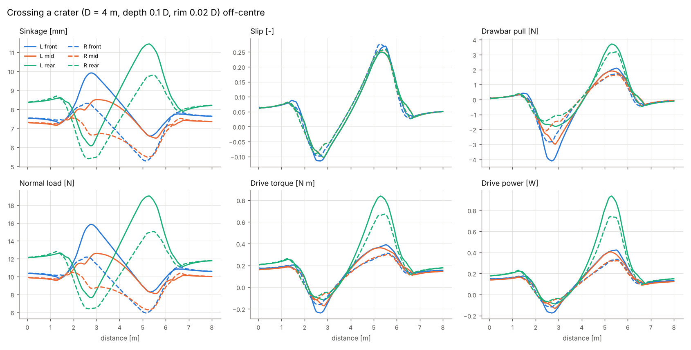
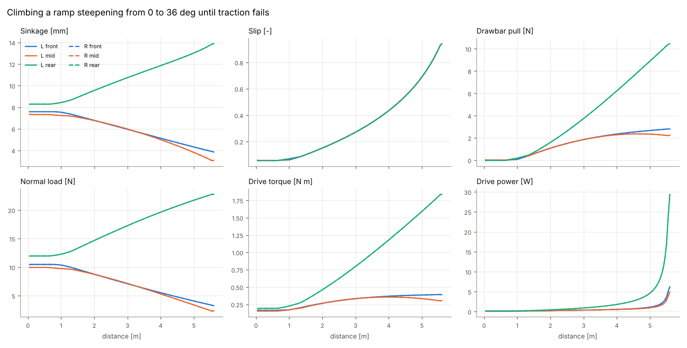
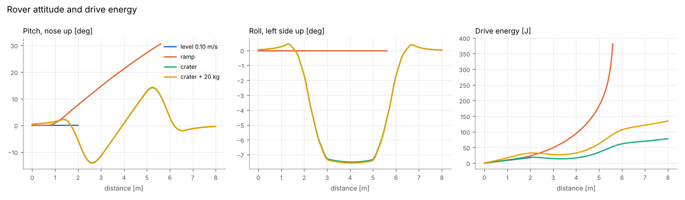
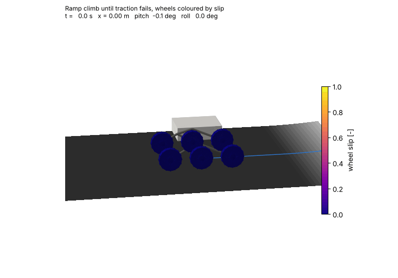
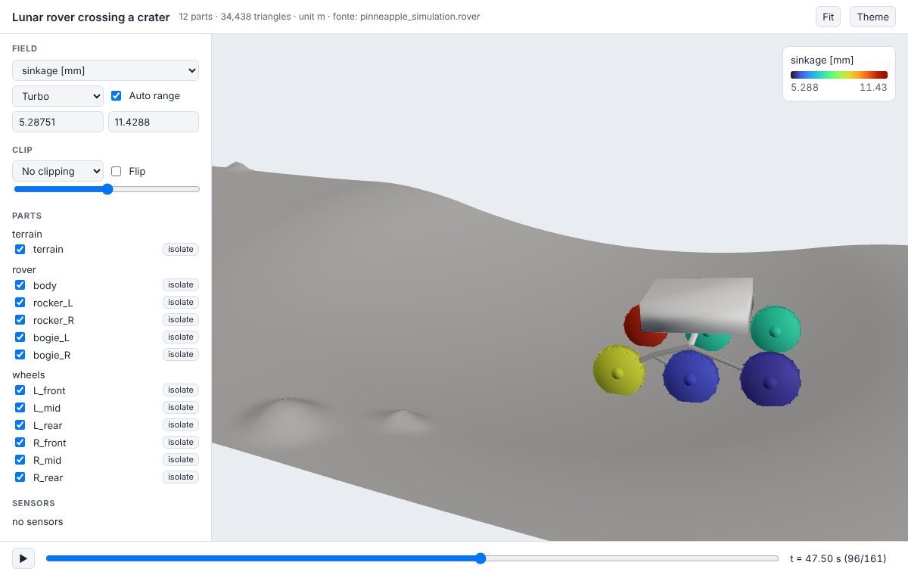

# Lunar rover terramechanics in 3D

`pinneapple_simulation.rover` puts the Bekker-Wong wheel model of the
[terramechanics use case](https://github.com/PINNeAPPle-Labs/PINNeAPPle/tree/main/examples/use_cases/terramechanics)
on a six-wheel rocker-bogie rover driving over lunar terrain (g = 1.62 m/s², GRC-1 regolith simulant). Each wheel's
force comes from the library's Bekker-Wong solver (`numerical_solvers.bekker_wong`), with the wheel's load,
sinkage and slip taken from the rover state.


```python
from pinneapple_simulation.rover import RoverParams, LunarTerrain, Crater, RoverSimulator, checks, viz

rover = RoverParams()                                       # generic small rover, see "Rover" below
terrain = LunarTerrain(craters=[Crater(4.0, 0.6, 4.0, rim_ratio=0.02, depth_ratio=0.1)])
sim = RoverSimulator(rover, terrain)                        # Bekker-Wong (Gauss-Legendre) wheels
traj = sim.run(distance=8.0, v=0.1, dt=0.5)                 # speed held; the drive finds its slip
traj.summary(), traj.wheel_table(), traj.energy_per_metre()
sim.max_slope()                                             # steepest uniform grade it can climb [deg]
viz.animate(traj, "run.gif", path_mp4="run.mp4")            # wheels coloured by sinkage
viz.twin_scene(traj).export("viewer/")                      # the three.js twin viewer, rover parts animated
```

The complete study (every scenario, the verification and the figures on this page) is
`examples/use_cases/terramechanics/lunar_rover_3d.py`. It takes 412 s on one CPU and writes the numbers below to
[`results.json`](../assets/lunar_rover/results.json).

## Model

| Part | What it does |
|---|---|
| `geometry` | `RoverParams`; rocker-bogie kinematics (`link_frames`), meshes, `export_rover(path)` to glTF (.glb) or STL |
| `terrain` | `LunarTerrain`: planar grade, a ramp of growing grade, craters, rocks, soil regions |
| `contact` | `BekkerWongContact` (Gauss-Legendre or adaptive `quad`), `SurrogateContact` (e.g. the use case's PINN, with range flags) |
| `dynamics` | `RoverSimulator`: equilibrium per step, `run`, `steady_on_slope`, `max_slope`; `Trajectory` outputs |
| `checks` | the verification functions used below |
| `viz` | time-series PNGs, GIF/MP4 animation, twin3d scene |

**Rover body and suspension.** All mass sits in the body; rockers, bogies and wheels are massless links with
frictionless pivots. A differential makes the right rocker angle the negative of the left one. At each step the
unknowns (body height, pitch, roll, rocker angle, two bogie angles) satisfy six equations: force balance along the
body normal, roll and pitch moments about the centre of mass, the moment of each bogie about its pivot, and equal
pivot moments on the two rockers (the differential). The soil acts on each wheel as its Bekker-Wong force at the
axle plus the soil torque −M_y, so the drive torque reaction loads the rear wheel of each bogie.

**Longitudinal motion.** Speed mode holds the rover speed and solves for the common wheel speed, written as a
commanded slip `s_cmd`. If no `s_cmd ≤ s_limit` (default 0.95) balances the grade, traction has failed. Slip mode
fixes `s_cmd` and reports the pull the rover can deliver, as in a drawbar-pull test. Both use a backward-Euler
step along the path.

**Wheel-soil state.** Sinkage is how far the wheel penetrates the local terrain surface. It is found by sampling
the profile in the wheel plane and refining the foot point on the tangent plane. Slip comes from the wheel
speed and the wheel-centre velocity along the terrain: `s = 1 - v/(ωR)` when driving and `s = ωR/v - 1` when
braking. Wheel power is `M_y ω`. Energy per metre is the drive energy (mechanical, at the wheel) divided by the
distance.

**Solver.** Each step has two stages. First a kinematic predictor places every wheel at its previous sinkage on
the terrain at the new position. Then a bounded least-squares solve (SciPy `least_squares`) finds the force
equilibrium. Without the predictor, a wheel passing a crest can lose contact in the first guess, and the solve
then stops on a "four wheels down" branch.

### Why not the Newton backend

The Newton rigid-body backend (`external_solvers.newton_physics`) solves Coulomb contact against a plane or
meshes. Its wrapper has no hook to apply a per-wheel force law at each step, and Newton/Warp are not installed in
the test environment. Bekker-Wong is a steady-state law (forces as a function of slip and sinkage, with no
loading history). For that reason the rover uses the quasi-static formulation above instead of an explicit
integrator with soil "springs".

## Rover, soil and terrain inputs

- **Rover.** Every value is generic, not taken from a real rover. The wheel is R = 0.125 m, b = 0.06 m, as in the
  terramechanics use case (`WheelParams`). Total mass is 40 kg (also from the use case), track 0.60 m, wheelbase
  0.70 m. The rocker pivot is 0.15 m above the wheel centres and the bogie pivot 0.05 m below it. Body inertia
  (uniform box 0.5 × 0.4 × 0.15 m) is (0.61, 0.91, 1.37) kg m². The proportions (front arm = 2 × rear arm, bogie
  pivot midway between its wheels) space the wheels equally. Grousers (`n_grousers`) are drawn but ignored by the
  contact law.
- **Soil.** GRC-1 compacted, as in the use case: c = 1400 Pa, φ = 30°, K = 0.018 m, k_c = 1370 N/m^(n+1),
  k_φ = 814 000 N/m^(n+2), n = 1, Wong's a0 = 0.40, a1 = 0.15. `SoilRegion` assigns other parameter sets to
  circles or boxes. No second published Bekker set is shipped: none could be checked against its source for this
  work.
- **Craters.** The bowl is `h_rim + d(ρ² − 1)` and the flank `h_rim ρ⁻³`, joined by a smooth minimum.
  - Default depth/diameter is 0.2, Pike's value for fresh simple lunar craters (Pike, R.J., 1977, *Apparent
    depth/apparent diameter relation for lunar craters*, Proc. Lunar Sci. Conf. 8th, 3427–3436).
  - The flank decays as ρ⁻³, like ejecta thickness in McGetchin, Settle & Head (1973), *Earth Planet. Sci. Lett.*
    20, 226–236.
  - Rim height is a required input. No published value is built in.
- **Rocks** are smooth bumps placed uniformly at random (no published size-frequency law). They are geometry
  only: a wheel on a rock still gets the regolith law.

## Verification (numbers from the run)

| Check | Result |
|---|---|
| Level-ground sinkage on a pressure-only soil (shear off, front contact) vs Bekker's closed form for a rigid wheel, z = [3W / ((3−n) b k √D)]^(2/(2n+1)) | max relative difference **0.67 %** over the six wheels (e.g. 8.229 mm vs 8.175 mm at 12.37 N). Against the exact integral of the same pressure law: **1.5 × 10⁻¹³** |
| Every wheel of the full model vs the standalone `BekkerWongSolver` (adaptive `quad`): sinkage for the wheel's load and slip, then F_x, M_y | max relative difference **≤ 1.1 × 10⁻¹⁰** at slips 0.05–0.7 |
| Force and moment balance recomputed from the stored wheel forces, 557 converged states (level, ramp, crater, crater with payload) | force **4.7 × 10⁻¹²** m g, roll/pitch moment **7.3 × 10⁻¹³** m g L. The yaw moment (up to 0.024 m g L) is not balanced, because the path is imposed |
| Maximum grade, full model (bisection on uniform grades) vs "drawbar pull = grade resistance" for six equally loaded wheels at the same limit slip 0.95 | **28.8° vs 31.5°** (40 kg); **25.7° vs 28.1°** (60 kg). The full model is lower because the grade and the drive torque move load to the rear wheels, and drawbar pull is not linear in load |
| Ramp steepening from 0° to 36°, driven until traction fails | stops at x = 5.55 m with **28.85°** under the body (27.9°–31.1° under the wheels), against 28.8° from the uniform-grade bisection |
| Published single-wheel or rover test data | **none used**: no source with exact values for this soil and wheel could be checked |

### The PINN surrogate along the trajectories

`SurrogateContact.from_torchscript` loads the TorchScript surrogate written by `terramechanics_rover_pinn.py`. The
check evaluates it at every loaded (slip, sinkage) of the numerical runs and flags inputs outside its training box.
Two versions were checked. The first is the use case's network as trained (slip 0–0.75, sinkage 2–58 mm). The
second is the same network and losses retrained on a box sized for this rover (sinkage 2–25 mm), using the new
`slip_range`/`sinkage_range` arguments of `train()`.

| Run | inputs outside the box | box 2–58 mm: RMSE F_x / F_z / M_y (inside) | box 2–25 mm: RMSE F_x / F_z / M_y (inside) |
|---|---|---|---|
| Level, 3 speeds (738 wheel states) | 0 % | 1.89 N / 0.38 N / 2.13 N m | 1.10 N / 0.32 N / 0.33 N m |
| Ramp to traction loss (672) | 7.1 % (slip > 0.75) | 1.85 N / 0.84 N / 2.08 N m | 1.25 N / 0.30 N / 0.35 N m |
| Crater (966) | 20.1 % (braking, slip < 0) | 1.86 N / 0.68 N / 2.09 N m | 1.16 N / 0.26 N / 0.34 N m |

For scale, on level ground each wheel carries about 10–12 N and needs 0.15–0.19 N m. Both surrogates are trained
on boxes whose loads reach tens of newtons, so their absolute errors are of the order of the torques this rover
needs. Driving the rover with either surrogate up a 10° grade fails at the first step. The bogie moment balance
has no solution because the surrogate's torque error moves more load than a bogie wheel carries. The surrogate
is therefore **not usable** for this rover as trained. The numerical law costs about 2.3 ms per evaluation of all six
wheels, and a 6 m crater crossing (121 steps) ran in 18 s. A surrogate for this rover would need a box and a loss
scaled to its loads and torques (e.g. a relative error on M_y). The range flags and the comparison are built in,
so a retrained network can be checked the same way.

## Scenario results

| Scenario | Result |
|---|---|
| Level traverse at 0.05, 0.10, 0.20 m/s | slip 0.056, **8.69 J/m** at every speed (the law has no rate dependence). Loads 10.5 / 9.95 / 12.0 N (front/mid/rear), sinkage 7.3–8.3 mm, torque 0.15–0.19 N m |
| Drawbar pull / weight vs slip (level) | −0.009 (s = 0.05), 0.057 (0.1), 0.169 (0.2), 0.260 (0.3), 0.389 (0.5), 0.471 (0.7) |
| Steady climbing: slip and energy per metre | 0°: 0.056, 8.7 J/m · 10°: 0.219, 25.2 J/m · 20°: 0.479, 59.2 J/m · 25°: 0.689, 117 J/m · 27.5°: 0.843, 250 J/m. Rear wheel load grows from 12.0 N to 22.0 N |
| Maximum grade | **28.8°** (40 kg), **25.7°** with a 20 kg payload |
| Crater crossing (D = 4 m, depth 0.1 D, rim 0.02 D, path 0.6 m off-centre) | completed. Pitch −14.0° to +14.2°, roll up to 7.5°, sinkage up to 11.4 mm, slip −0.11 to 0.28, **9.71 J/m** |
| Crater crossing with 20 kg payload | completed, sinkage up to 15.5 mm, **16.8 J/m** |
| Level traverse with 20 kg payload | slip 0.060, sinkage 9.5–11.0 mm, **15.0 J/m** |

The crater depth (0.1 D) and rim (0.02 D) are scenario inputs for a degraded crater, not published values. The
fresh crater beside the path uses Pike's 0.2 and is scenery only.







Climbing until traction fails, wheels coloured by slip:



Also: [crater crossing MP4](../assets/lunar_rover/crater_crossing.mp4),
[level traverse per wheel](../assets/lunar_rover/A_level_wheels.png),
[rover glTF](../assets/lunar_rover/rover.glb).

The twin viewer (`viz.twin_scene(traj).export(folder)`, open it through `python -m http.server -d folder`) plays the
run with the body, rockers, bogies and wheels moving. Wheels are coloured by sinkage or slip at each step:



`pinneapple_twin3d.Scene.add_motion(part, positions, quaternions)` adds this rigid motion per time step to any
twin scene. The manifest lists the motions and their data is stored in `fields.bin`.

## Assumptions and limits

- **Bekker-Wong validity.** The law is semi-empirical and steady-state, and its soil parameters come from plate
  tests. In Apollo-era soil bin tests with the final Lunar Roving Vehicle wheel, the Bekker method over-predicted
  performance (*The Development of Wheels for the Lunar Roving Vehicle*, NASA NTRS 20100000019). Treat absolute
  values as model output, not as predictions of a real rover.
- **No soil flow, no history.** Sinkage is not remembered: there is no multi-pass compaction or rut following,
  bulldozing, side walls or slip-sinkage beyond Wong's θ_m shift. Each wheel sees undisturbed soil.
- **No wheel-wheel interaction.** Rear wheels do not run in the front wheels' ruts.
- **2D contact per wheel.** Forces act in the wheel plane. Lateral forces are not modelled by a soil law: a
  reaction proportional to the wheel loads closes the lateral balance, and the rover follows a straight imposed
  path (no side slip, no yaw dynamics, no steering).
- **Quasi-static attitude.** There are no body or link inertia effects (the inertia tensor is reported, not used)
  and no bouncing. Only the longitudinal motion has dynamics.
- **Grousers** are drawn but not in the contact law. **Rocks** are geometry with the regolith law, so contact on a
  rock is not rigid.
- **Traction failure** means no equilibrium with commanded slip ≤ 0.95. Bekker-Wong pull still grows slowly up to
  slip 1, so the maximum grade depends on this limit.
- **Mechanical energy** is the soil torque times the wheel speed. Motor, gear and electronics losses are not
  included.
