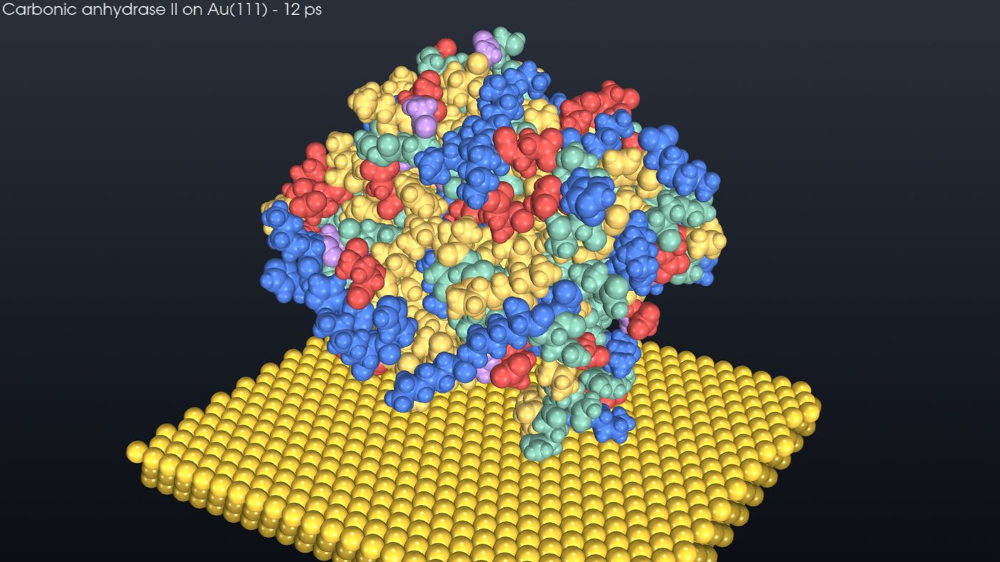
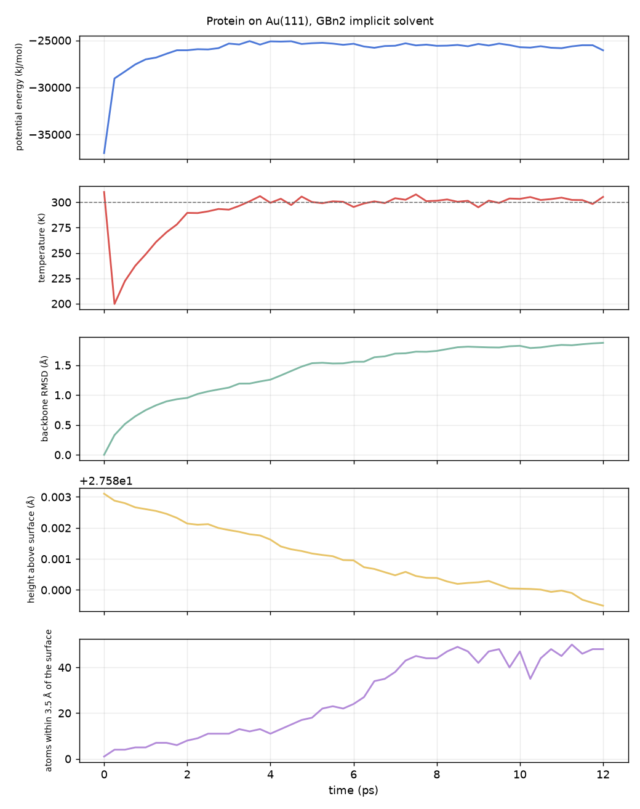

# Molecular visualisation: proteins on metal surfaces

`pinneapple_tools.visualization.molecular` (also `pp.molecular`) shows molecules alone or adsorbed on metal surfaces.
It covers the visual side of a protein-on-metal molecular dynamics (MD) pipeline, such as RoyalMD Gold
(TheVisualHub/RoyalMD_Gold) runs with OpenMM. It contains no MD engine: anything that gives atom positions can be
shown, such as a PDB file, an OpenMM or mdtraj trajectory, or the torch MD of `pinneapple_simulation`.



| Function | What it does |
|---|---|
| `Molecule.from_pdb`, `Molecule.from_mdtraj` | Read atoms, elements, residues and chains; multi-MODEL PDB files give the frames. Also provide the CA backbone trace and the residue class (hydrophobic, polar, positive, negative, special) |
| `fcc_slab(metal, facet, nx, ny, layers)` | fcc slab of Au, Ag, Cu, Pt, Pd, Ni, Al or Pb, with a (111), (100) or (110) top facet, in whole lattice repeats so a periodic box does not strain it |
| `slab_for_footprint(xyz, ...)` | Size the slab from a molecule's footprint plus padding, centred under the molecule |
| `orient_on_surface(xyz, masses, active_site, gap)` | Turn the thinnest principal direction toward the surface normal (broadest face down), turn the active site away from the surface, place the lowest atom `gap` Å above it |
| `render(...)` | Off-screen still with pyvista: space-filling or backbone tube, coloured by residue class, element, chain or height, on a metallic slab with three-point lighting |
| `render_frames(...)` + `encode_mp4(...)` | Trajectory as PNG frames (fixed camera or slow orbit, time labels) and an H.264 MP4 (imageio-ffmpeg) |
| `md_dashboard(...)` | Potential energy, temperature, backbone RMSD, height above the surface and contacts over time |
| `rmsd`, `height_above`, `contacts` | The analysis behind the dashboard |
| `to_glb(...)` | glTF scene (one mesh per residue class and the metal), for the PINNeAPPle web viewer or any glTF viewer |
| `StepLog` | Numbered, optionally coloured, step-by-step console log of a pipeline |

`pinneapple_tools.visualization.studio.particles.compose_video` adds live charts next to the rendered frames.

```python
from pinneapple_tools.visualization.molecular import Molecule, orient_on_surface, slab_for_footprint, render

mol = Molecule.from_pdb("protein.pdb")
xyz = orient_on_surface(mol.xyz, mol.masses, gap=3.0)
slab, cell, _ = slab_for_footprint(xyz, "Au", "111", padding=6.0)
render(mol, "protein_on_gold.png", xyz=xyz, slab=slab, color_by="residue")            # or style="cartoon"
```

## Example: carbonic anhydrase II on Au(111) with OpenMM

`examples/molecular/protein_on_gold.py protein.pdb --ps 12` runs these steps:

1. Repair the structure with pdbfixer.
2. Orient it on the surface and build an Au(111) slab under its footprint.
3. Set up Amber14 with GBn2 implicit solvent. Gold acts on every protein atom through the INTERFACE Lennard-Jones
   parameters (σ = 2.629 Å, ε = 5.29 kcal/mol; Heinz et al. 2008), summed over the lattice as a Steele 10-4-3 wall.
4. Minimise, then run Langevin dynamics at 300 K.
5. Write stills, an MP4, the MD dashboard and a glTF scene.

The example uses a flat wall and not explicit gold atoms: on a CPU, explicit atoms inside the implicit solvent cost
far more. The pictures still show the explicit slab. A run of tens of picoseconds shows thermal motion and the first
contacts. It is a visualisation demonstration, not an equilibrated adsorption study. The OpenMM bridge with verified
equilibration is issue #460; explicit slabs, restraints and orientation sampling are issue #461.

Result of the run in the picture: 12 ps of dynamics on 4 CPU cores (about 20 minutes).

- Temperature settles at 300 K within 4 ps. The early dip comes from the constrained degrees of freedom absorbing
  the initial velocities.
- The backbone RMSD rises to 1.9 Å.
- The number of atoms within 3.5 Å of the gold grows from 1 to 48 while the centre of mass barely moves: side
  chains reach down to the surface.
- [MP4 of the trajectory](../assets/molecular/trajectory.mp4), with a slow orbit and a time label.



Tests: `tests/test_molecular_viz.py`. They check PDB reading, slab geometry (nearest-neighbour distance a/√2 and layer
spacing for each facet), orientation, RMSD invariance to rigid motion, renders, glTF and MP4.
