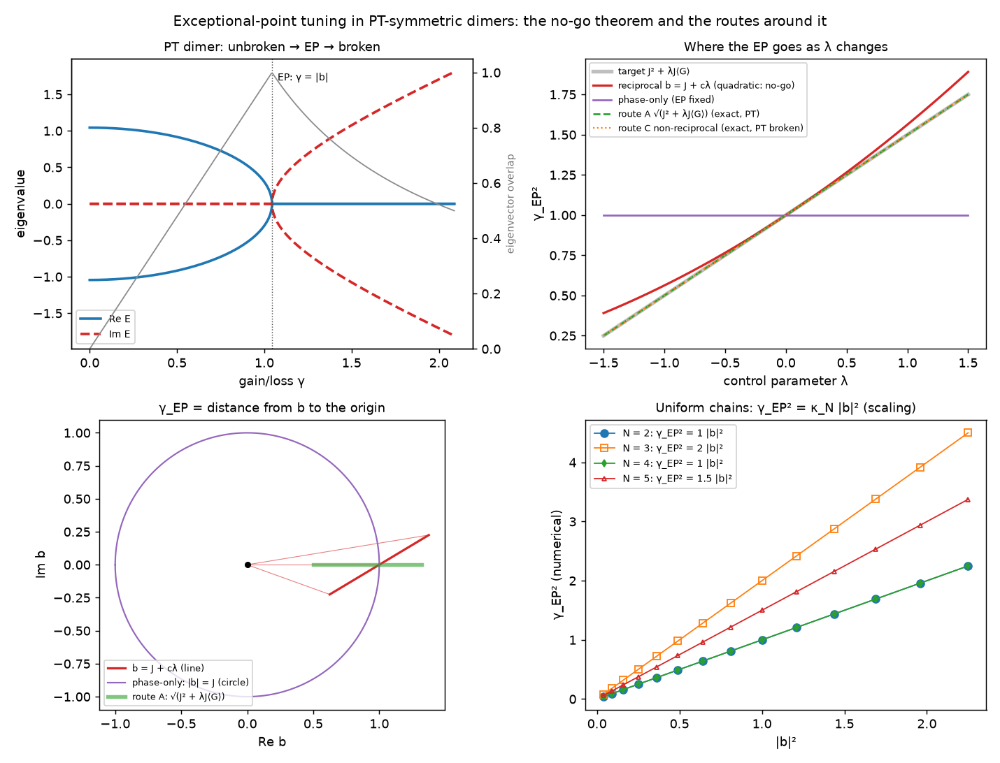

# Non-Hermitian physics: PT-symmetric dimers and exceptional-point tuning

`pinneapple_physics.non_hermitian` (also `pp.non_hermitian`) models PT-symmetric dimers and chains, finds their
exceptional points (EPs), and checks whether a control parameter can move an EP along a desired law. It implements
and verifies the no-go theorem of *"A No-Go Theorem for Exceptional-Point Tuning in PT-Symmetric Dimers"* (Zenodo
record 23287622).



## The dimer and its exceptional point

`H = [[ε + iγ, b], [b*, −iγ + ε]]` is PT symmetric: P H* P = H, with P = σx. Its eigenvalues are
`ε ± sqrt(|b|² − γ²)`.

- For γ < |b| the spectrum is real (unbroken phase).
- At γ = |b| the eigenvalues **and** the eigenvectors coalesce. This is the EP.
- Beyond it the eigenvalues form a complex-conjugate pair (broken phase).

`PTDimer` returns the following:

| Quantity | Method |
|---|---|
| Closed-form EP location | `ep_gamma` |
| EP found from the matrix alone (independent check) | `ep_gamma_numeric` |
| Phase (unbroken, EP or broken) | `phase` |
| Eigenvector overlap, which goes to 1 at the EP | `eigenvector_overlap` |
| Petermann factor, which diverges at the EP | `petermann_factor` |
| Square-root splitting near the EP | `splitting` |

`PTChain` does the same for N sites. There the EP can be of higher order: the trimer's is an EP3 at γ = √2 |b|.

## The no-go theorem, checked symbolically

```python
import sympy as sp
from pinneapple_physics.non_hermitian import analyze_ep_tuning
from pinneapple_physics.non_hermitian.ep_tuning import _symbols

lam, J, G = _symbols()                      # lam real, J > 0, G real; target gamma_EP^2 = J^2 + lam J G
print(analyze_ep_tuning(J + sp.Symbol("c") * lam))
# gamma_EP^2(lam) = J**2 + J*c*lam + J*lam*conjugate(c) + c*lam**2*conjugate(c)
# class: reciprocal polynomial; exact target realised: NO; degree in lam: 2
# no-go theorem APPLIES: exact linear tuning is impossible in this class
print(analyze_ep_tuning(sp.sqrt(J**2 + lam*J*G)).exact)   # True  (route A, PT symmetric)
print(analyze_ep_tuning(J, J + lam*G).exact)               # True  (route C, PT broken)
```

For a reciprocal coupling b(λ) = J + c₁λ + … + cₙλⁿ, the EP law γ_EP² = |b(λ)|² is a polynomial of degree 2n whose
leading coefficient |cₙ|² is positive. It therefore cannot equal the linear target. The report gives:

- the EP law and its degree;
- the residual against the target;
- the class of the coupling;
- which of the four assumptions hold (A PT symmetry, B dimension 2, C polynomial coupling, D reciprocity);
- whether the theorem applies.

The classes and the ways around the obstruction:

| Coupling | EP law | Exact linear tuning? | PT symmetric? |
|---|---|---|---|
| Phase only, J e^{iφ(λ)} | J², fixed | no | yes |
| Reciprocal polynomial, J + cλ + … | degree ≥ 2 | **no (no-go)** | yes |
| Route A, √(J² + λJ⟨G⟩) | J² + λJ⟨G⟩ | yes | yes |
| Route B, state-dependent feedback | (conjecture) | see note | yes |
| Route C, non-reciprocal: b_ab = J, b_ba = J + λ⟨G⟩ | J² + λJ⟨G⟩ | yes | **no** |

**Note on route B.** `feedback_coupling` updates the coupling from a measurement of itself with a polynomial map,
`b ← (b + (J² + λJ⟨G⟩)/b)/2`. Its fixed point is the route-A coupling. This shows that feedback *can* produce the
non-polynomial dependence the theorem rules out for static couplings. It is an illustration, not a proof of the
paper's Conjecture 1 for any physical feedback mechanism.

## The hypothesis map as a physics audit

`theorem_profile()` states assumptions A–D as a `physics_audit.ModelProfile`, and `design_features(H, polynomial)`
reads them from a device Hamiltonian. Auditing a design then says whether the theorem constrains it:

- all assumptions `VALID`: linear tuning is out of reach for this design;
- an assumption `VIOLATED`: the theorem does not apply, and the violated assumption names the route that opened up.

```python
from pinneapple_physics.physics_audit import audit_assumptions
from pinneapple_physics.non_hermitian import theorem_profile, design_features, PTDimer, route_c_asymmetric

ab, ba = route_c_asymmetric(1.0, 0.5)
print(audit_assumptions(theorem_profile(), design_features(PTDimer(ab, ba).hamiltonian(0.5, 1.0), polynomial=True)))
# no_go_ep_linear_tuning: VIOLATED ... [VIOLATED] pt_symmetry ... [VIOLATED] reciprocal_coupling ...
```

## Beyond the dimer

For a chain with uniform coupling, H(γ, b) = |b| H(γ/|b|, 1) after a gauge transformation. So
γ_EP = κ_N |b| exactly, and the dimer's obstruction carries over to every N. Numerically, κ_N² is:

| N | κ_N² | EP order |
|---|---|---|
| 2 | 1 | EP2 |
| 3 | 2 | EP3 |
| 4 | 1 | EP2 |
| 5 | 1.5 | EP3 |

This scaling argument does **not** cover chains where the control parameter changes only some bonds. That case is the
paper's open question Q2 (Conjecture 2).

Tests: `tests/test_non_hermitian.py`. Figure: `pinneapple_physics.non_hermitian.viz.ep_tuning_figure`.
