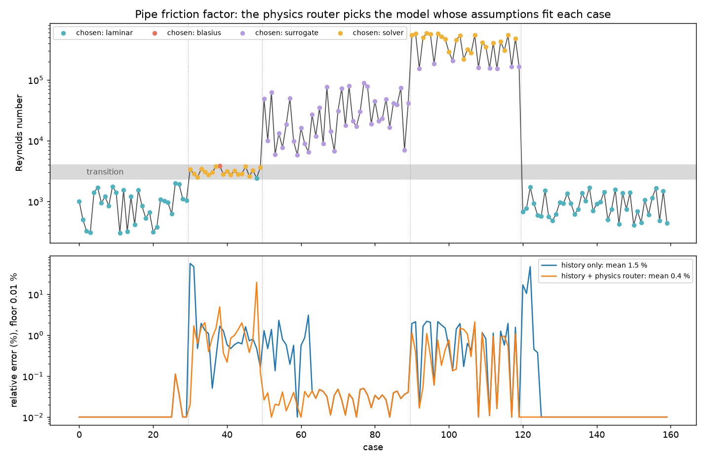

# Physics audit: which model to use, when to trust it, when to revisit the physics

> "It is in the fundamental knowledge that we must look for the cause of a model's imperfections."

An adaptive ensemble picks the best model from the errors each one made on earlier cases. That leaves two questions
open:

- Is the current case still inside the physics each model was built on?
- When a model fails, why did it fail?

`pinneapple_physics.physics_audit` (also `pp.physics_audit`) adds those layers on top of the predictive models. It is
plain numpy and does not import torch.

| Layer | What it does | Module |
|---|---|---|
| 1. Predictive models | PINN, FNO, GNN, DeepONet, CNN, solvers, closed forms | `pinneapple_physics.ensemble` experts |
| 2. Physical evaluation | Residuals, conservation, bounds, boundary conditions and invariants, without ground truth. Each model's assumptions and the regime of the case | `monitor`, `assumptions`, `regime` |
| 3. Adaptive decision | Compatibility of the case with each model's physics, used as a prior on the ensemble weights. Models outside their physics sleep, and the router escalates to the solver | `routing` |
| 4. Diagnosis and evolution | Probable cause of a failure, with its evidence and a confidence. Next experiment or change of highest value. Graph of phenomena, equations, assumptions and models | `attribution`, `improvement`, `knowledge` |

## Assumptions and their validity (Physics Assumption Auditor)

A `ModelProfile` is the model card that the audit reads. It holds:

- the model's equations;
- its assumptions, taken from the catalogue or written by you;
- the mechanisms it represents;
- its training envelope.

Each assumption holds inside a range of dimensionless numbers, with a soft band around the edges. Near a transition
the audit says `MARGINAL`; it does not flip from valid to violated. A feature that is not given is `UNKNOWN`, never a
silent pass.

```python
from pinneapple_physics.physics_audit import ModelProfile, Envelope, laminar, audit_assumptions, regime_features

f = regime_features(velocity=0.12, length=0.05, nu=1e-6)          # {"Re": 6000, "Fr": ...}
lam = ModelProfile("laminar", "closed form", ("Hagen-Poiseuille / laminar correlations",),
                   (laminar(2300), "incompressible"), envelope=Envelope({"Re": (1, 2300)}))
print(audit_assumptions(lam, {**f, "Ma": 0.05}))
# laminar: VIOLATED (compatibility 0.00)
#   [VIOLATED] laminar: Re <= 2.3e+03 (Re = 6e+03): VIOLATED
#   [VALID] incompressible: Ma <= 0.3 (Ma = 0.05): VALID
#   [OUTSIDE] training envelope: Re = 6e+03, trained on 1 .. 2.3e+03 (outside)
#   probable phenomena: turbulence
```

**Catalogue.** `ASSUMPTIONS` lists the common simplifications. The factory functions build them with other
thresholds.

- Flow regime: `laminar`, `turbulent`, `hydraulically_smooth`, `creeping_flow`, `attached_flow`
- Fluid behaviour: `incompressible`, `continuum`, `boussinesq`, `constant_properties`, `shallow_water`
- Structures: `small_strain`, `linear_elastic`
- Heat and transport: `lumped_capacitance`, `forced_convection`, `diffusion_dominated`, `advection_dominated`

**Features.** `regime_features` and the functions in `regime` compute these numbers:

- Re, Ma, Pe, Kn, Ri, Ra, Gr, Pr, Bi, Fr, St and Da;
- β·ΔT (`beta_dT`) and ΔT/T (`dT_over_T`);
- the roughness Reynolds number ε⁺.

**Training envelope.** An `Envelope` can come from training samples (`Envelope.from_samples`). It then also measures
the distance to the nearest training case, so a case that sits in a hole of the data is flagged even when it is
inside every range.

## Validity monitor (no ground truth needed)

`PhysicsValidityMonitor` runs the checks below on every prediction:

| Check | What it measures |
|---|---|
| `residual_check` | Norm of the residual of the governing equations |
| `conservation_check` | Conserved total against its expected value |
| `bounds_check` | Admissible values, such as non-negative density (critical by default) |
| `boundary_check` | The prediction against the boundary condition |
| `constitutive_check` | Violation of a material or constitutive law |
| `invariant_check` | Change of a quantity that must stay constant |
| `envelope_check` | Distance outside the training envelope (extrapolation) |

The status goes from `OK` to `WARN` and then `ALARM`. An alarm is raised when:

- a critical check fails;
- the same check fails `persistence` times in a row;
- a residual drifts to `drift_ratio` times its own baseline, even while it is still below its tolerance.

## Physics-aware routing

`PhysicsAwareRouter` turns the compatibility of the current case with each model into a prior on its weight:

`w_i ∝ w_learned_i · max(c_i, floor)^strength · exp(-cost_weight · cost_i / max cost)`

- **Sleeping models.** A model below `abstain_below` is asleep. It is not used for that case, and inside the ensemble
  the case does not change its weight: its loss is set to the mixture's. A laminar correlation is therefore not
  punished for the turbulent cases it was never meant for. It is ready again as soon as the flow returns to its
  regime.
- **Escalation.** When no model fits (best compatibility below `escalate_below`), the router escalates to the solver
  named in `escalate_to`.

```python
from pinneapple_physics.ensemble import PhysicsEnsemble
from pinneapple_physics.physics_audit import PhysicsAwareRouter

router = PhysicsAwareRouter(profiles, features_fn=lambda case: case["features"],
                            escalate_below=0.9, escalate_to="solver")
ens = PhysicsEnsemble(experts, mode="select", router=router)
out = ens.predict(case)          # also returns "prior", "awake" and "escalate"
print(router.route(case))        # standalone decision, with the reasons
```

The learned weights, the residual look-ahead and the cost term of the ensemble still apply on top of the prior. So
history and the current residual can correct a compatibility estimate that is wrong.

## Failure attribution

`attribute_failure` weighs the evidence of one case and returns the probable causes, each with a probability and its
evidence. The confidence of the diagnosis drops when evidence types are missing, and the report lists which ones
were.

| Cause | Evidence |
|---|---|
| `pde_violation` | The residual fails its tolerance or jumps above its in-domain level |
| `conservation` | A conserved total is off |
| `boundary_condition` | The prediction does not meet the boundary condition |
| `regime_change` | The case violates an assumption of the model |
| `extrapolation` | The assumptions hold, but the case is outside the training envelope, far from the training cases, or the models disagree |
| `numerical_resolution` | Grid convergence index, change under refinement, CFL above its limit, or non-finite or out-of-bounds values |
| `measurement` | The reference reading failed its own physical consistency check |
| `missing_physics` | The model satisfies its equations, inside its assumptions and envelope, and still disagrees with the reference (model-form error) |

Low residuals do not guarantee a correct prediction, and high residuals alone do not identify the cause. The last row
is the case where the residual misleads. When there is no reference, a low residual comes with a note that it does
not prove the prediction right.

## Knowledge graph and guided improvement

`default_graph(profiles)` links phenomena, equations, assumptions, parameters, mechanisms and models. It answers
questions such as:

- `unrepresented(model, features)`: Re went up, so is turbulence represented in this model?
- `models_for(mechanism)`: which models represent this mechanism?
- `explain(model, features)`: a readable account of what the model misses for this case.

`to_mermaid()` draws the graph.

`recommend(attribution, audit, graph, features, model)` ranks the next steps by
`probability × confidence × gain / cost`:

- switch to a model or equation that represents the missing mechanism (the graph names it);
- run high-fidelity simulations in the new regime, with design points around the case;
- train a specialised model;
- add collocation points or change the loss;
- add a conservation projection;
- enforce the boundary condition exactly;
- refine the mesh;
- check the sensor;
- add the missing term or fit a discrepancy model.

`improvement_plan(cases)` aggregates many cases, so the actions that fix the most frequent and most confident causes
come first.

`diagnose(profile, features, prediction, query, monitor, error)` runs all of this for one case and returns a
`Diagnosis` with `trusted` and a Markdown `report()`.

## Example: pipe friction across regimes



`examples/physics_audit/pipe_regimes.py` predicts the Darcy friction factor of a rough pipe (ε/D = 1e-3) for 160 cases.
The Reynolds number goes through the laminar, transitional, turbulent and high-Re rough regimes, then back to laminar.
The truth is Churchill's correlation. The models:

| Model | Formula or source | Assumes | Training envelope | Cost |
|---|---|---|---|---|
| `laminar` | 64/Re | Laminar flow | Re ≤ 2300 | 1 |
| `blasius` | Smooth-pipe Blasius | Turbulent flow, smooth wall | 4000 ≤ Re ≤ 1e5 | 1 |
| `surrogate` | Learned surrogate | Turbulent flow | 4000 ≤ Re ≤ 2e5 | 1 |
| `solver` | High-fidelity, 1 % noise | — | — | 100 |

Mean relative error over the 160 cases:

| | laminar | transition | turbulent | high Re, rough | laminar again | all | solver share |
|---|---|---|---|---|---|---|---|
| History only (`PhysicsEnsemble`) | 0.01 % | 5.9 % | 0.33 % | 1.0 % | 1.9 % | 1.49 % | 21 % |
| **History + physics router** | 0.01 % | 2.1 % | **0.03 %** | **0.59 %** | **0.00 %** | **0.38 %** | 25 % |
| Physics router alone | | | | | | 2.27 % | 27 % |
| Best single model (surrogate) | | | | | | 12.3 % | |

**Back in laminar flow.** On the first five laminar cases, the history-only ensemble keeps the turbulent surrogate,
with errors of 17 %, 11 % and 47 %, and then falls back to the expensive solver. With the router, the laminar law
answers from the first case, with no error, because it was asleep through the turbulent segment and kept its weight.

**Physics and history complement each other.** The router alone is worse than the router with history. Inside its
envelope, Blasius looks compatible with the case, but the pipe is rough. Only the errors it makes reveal that.

The example then diagnoses three failures:

1. **`laminar` at Re = 6000.** Regime change: the `laminar` assumption is violated. Turbulent transport is not
   represented. The recommendations are to use a model that represents it (`solver` or `surrogate`) or to run
   high-fidelity simulations in the new regime.
2. **`blasius` at Re = 5e5.** Regime change: `hydraulically_smooth` is violated with ε⁺ = 25, so the flow is in
   rough-wall turbulence and the model lacks the wall-roughness mechanism. The case is also outside the training
   envelope, and the smooth-pipe law residual fails.
3. **`blasius` at Re = 6e4.** Every assumption is valid, the case is inside the training envelope and the residual of
   the smooth-pipe law is 0.3 %, yet the error is 14.5 %. The cause is **missing physics** (p = 0.87): the model
   satisfies its own equations, but they do not describe this case. A residual check alone would have trusted this
   prediction.
