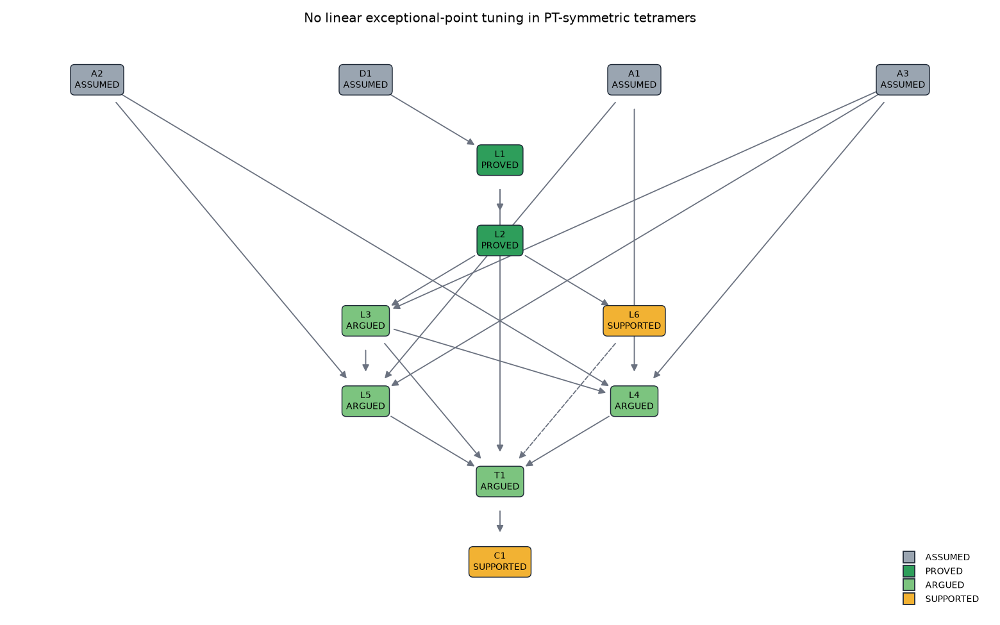

# Proof graphs: mathematics with the same evidence discipline

`pinneapple_analysis.proof` writes a mathematical argument as a graph. Each node is an assumption, definition,
lemma, theorem or conjecture, and carries machine checks. A node's status can only be as strong as its own evidence
and its dependencies. It is the same discipline as the physics audit, applied to theorems.

| Status | Meaning |
|---|---|
| ASSUMED | An assumption or definition, stated explicitly |
| PROVED | Every check is exact and passed (symbolic identity, exhaustive enumeration, integer or degree argument), and every dependency is PROVED or ASSUMED |
| ARGUED | The exact checks passed, but part of the argument is a written step the machine did not check, or a dependency is only ARGUED |
| SUPPORTED | Numerical evidence only (random tests, counterexample searches that found nothing) |
| REFUTED | A check found a counterexample |
| OPEN | No evidence, or a check that could not be decided |

The available checks:

- `symbolic_identity`, `symbolic_true` (sympy);
- `exhaustive`, over a finite set;
- `numeric`, on random samples;
- `counterexample_search`, by differential evolution;
- `custom`.

A theorem with no checks of its own is the composition of its lemmas. Nodes in `supported_by` corroborate a result
without lowering its status. `report()`, `to_mermaid()` and `plot()` show what supports each claim.
`RerunLogger.proof_graph` opens the graph in Rerun.

## Experiment: is exceptional-point tuning impossible beyond the dimer?

The no-go theorem for PT-symmetric dimers (Zenodo 23287622) leaves open, as Q2 and Conjecture 2, whether chains obey
the same restriction. For uniform chains the answer is yes, by scaling (`docs/core_concepts/non_hermitian.md`).
`examples/proof_graph/pt_chain_no_go.py` attacks the first non-uniform case: the PT tetramer whose outer and inner
bonds are modulated independently by polynomials in λ.

| Node | Claim | Evidence | Status |
|---|---|---|---|
| L1 | PT symmetry ⇔ b₃ = b₁; b₂ is free | sympy, exact | PROVED |
| L2 | det(E − H) = E⁴ + (γ² − 2A − B)E² + (A² − Bγ²), with A = \|b₁\|² and B = \|b₂\|² | sympy, exact | PROVED |
| L3 | The threshold lies on branch I (γ² = A²/B) or on branch II ((γ² − 2A + B)² = 4A(A − 2B)) | discriminant identities (exact); matrix vs branch formulas on 300 random (A, B) | ARGUED: the continuity step is written |
| L4 | Branch I cannot be linear: A² = Bℓ is impossible (degree 4·deg b₁ is even, 2·deg b₂ + 1 is odd) | leading-term identity, "4p = 2q + 1 has no integer solution" for all degrees (exact), exhaustive check up to degree 4 | own checks exact; ARGUED via L3 |
| L5 | Branch II cannot be linear: (B + ℓ)² = 4A(ℓ − B) forces p = q and then a positive leading coefficient B_l² + 4A_lB_l, or an odd/even degree mismatch | sympy, all degrees (exact), exhaustive check up to degree 4 | own checks exact; ARGUED via L3 |
| L6 | No quadratic modulation makes the matrix threshold a straight line | counterexample search, 2 runs, smallest margin 1.9e-4 | SUPPORTED, corroborates T1 |
| **T1** | **No PT-preserving polynomial modulation of a tetramer gives exact linear EP tuning** | composition of L1, L3, L4, L5 | **ARGUED** |
| C1 | The same holds for N ≥ 5 | pentamer counterexample search, nothing found | SUPPORTED |

**What this means.** T1 extends the dimer no-go theorem to tetramers with independently modulated bonds. Every
algebraic step is machine-checked for all degrees. The one step that is written and not machine-checked is in L3:
continuity in γ of the conditions for a real spectrum, which pins the threshold to the two branches. That step is
standard, and it is corroborated numerically against the matrix on random couplings. The graph therefore reports T1
as ARGUED, not PROVED.

For N ≥ 5 the restriction stays a conjecture backed only by numerical evidence. It is not checked with formal proof
tools (Lean, Coq).

Tests: `tests/test_proof_graph.py`.
