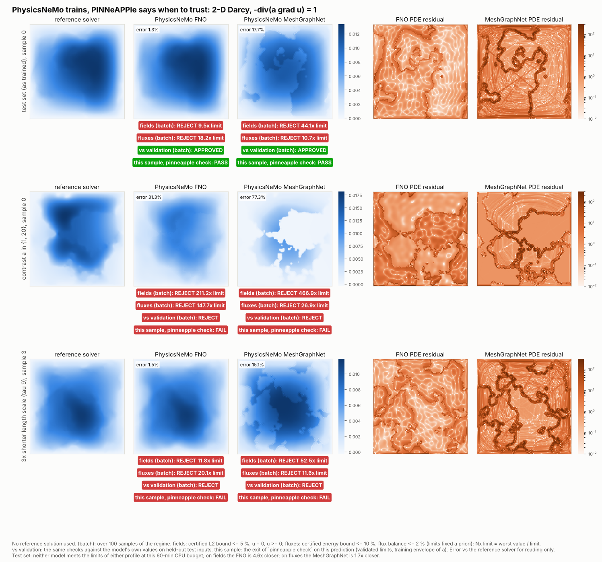

# PhysicsNeMo trains, PINNeAPPle says when to trust

PhysicsNeMo trains the models. PINNeAPPle checks whether their predictions can be trusted, without the reference
solution. The two complement each other: nothing below retrains or replaces a PhysicsNeMo model. The example is
[`examples/vs_physicsnemo/07_physicsnemo_trains_pinneapple_checks`](../../examples/vs_physicsnemo/07_physicsnemo_trains_pinneapple_checks/README.md).



An animated version cycles through six samples per regime: [physicsnemo_darcy_trust.gif](../assets/physicsnemo_trust/physicsnemo_darcy_trust.gif).

## Set-up

| | |
|---|---|
| Problem | `-div(a grad u) = 1` on the unit square, `u = 0` on the boundary, `a ∈ {3, 12}` (Li et al. 2021) |
| Data | zoo dataset `darcy_2d_li2021`: 1000 train / 200 test pairs on 128 × 128 cells, each solved on 512² and averaged |
| Models | PhysicsNeMo 2.2.2 `FNO` (4 layers, 12 modes, width 32, 2.37 M parameters) and `MeshGraphNet` on the 128 × 128 grid graph (15 message-passing steps, hidden 32, 0.15 M parameters; PyTorch Geometric) |
| Budget | `ComputeBudget(wall_s=3600)` each, 4 CPU threads (Xeon 2.8 GHz), Adam, cosine learning rate, relative L2 loss |
| Training reached | FNO 5144 steps = 41 epochs (train loss 0.012); MeshGraphNet 1828 steps = 3.7 epochs (train loss 0.15) |
| Regimes | test split (100 samples for calibration, 100 for evaluation); **contrast** `a ∈ {1, 20}`; **length scale** 3× shorter (`tau = 9`), 100 samples each, solved with the same reference solver (`operator_datasets.darcy_set`) |
| Time | data 4 min, training 2 × 60 min, evaluation 5 min, checks 2 ms per sample |

## The checks (no reference solution)

`pinneapple_physics.darcy_checks` uses the reference solver's own discretisation: cell-centred finite volumes,
harmonic-mean faces and half-cell Dirichlet faces. The solver's solution passes every check to round-off.

| Check | What it measures | Fixed limit |
|---|---|---|
| PDE residual | `residual_error_bound`: ‖r‖ in the dual norm of the constant-coefficient operator (one fast sine transform), divided by √min a and ‖u‖_A. It is a guaranteed upper bound on the relative energy-norm error with respect to the discrete solution. | 0.10 |
| Boundary condition | RMS of `u` extrapolated to the boundary, over max \|u\| | 0.02 |
| Flux balance | \|net outward flux − ∫f\| / ∫f | 0.02 |
| Positivity | most negative `u` / max \|u\| (maximum principle) | 0.01 |
| Applicability | `a` inside the training envelope (values, contrast, high fraction, interface density) | all inside |

Three verdicts per model and regime, each over the batch (90th percentile):

- **physics**: the fixed limits above.
- **vs validation** (`calibrate_tolerances`): the same four quantities against the model's own 99th percentiles on
  the 100 held-out in-distribution calibration inputs. Only inputs are needed, never labels. This layer is a drift
  monitor: it says whether the model is less physical here than where it was validated.
- **inputs**: the applicability check.

## Results

| Regime | Model | rel. L2 error (median / p90) | energy bound p90 | flux imbalance p90 | physics | vs validation | inputs |
|---|---|---|---|---|---|---|---|
| test set | FNO | 1.4 % / 2.3 % | 0.33 | 0.36 | REJECT | APPROVED | APPROVED |
| test set | MeshGraphNet | 15.3 % / 19.8 % | 1.07 | 0.21 | REJECT | APPROVED | APPROVED |
| contrast {1, 20} | FNO | 40.9 % / 48.9 % | 3.06 | 2.95 | REJECT | REJECT | REJECT |
| contrast {1, 20} | MeshGraphNet | 76.8 % / 86.3 % | 2.69 | 0.48 | REJECT | REJECT | REJECT |
| length scale ÷3 | FNO | 1.8 % / 2.5 % | 0.39 | 0.40 | REJECT | REJECT (marginal) | REJECT (39 % outside) |
| length scale ÷3 | MeshGraphNet | 15.0 % / 20.1 % | 1.16 | 0.23 | REJECT | REJECT (marginal) | REJECT (39 % outside) |

The reference solutions themselves give an energy bound of 0.024 / 0.090 / 0.031 and a flux imbalance of about
0.01 in the three regimes. That is the floor set by the 512² → 128² averaging.

What this shows:

1. **The FNO is the better model at equal budget.** On CPU it does 11× more epochs per hour than the MeshGraphNet
   (41 against 3.7) and ends with a 10× smaller test error. The MeshGraphNet is undertrained here. With 15
   message-passing steps it also sees at most 15 cells in each direction on a 128-cell grid, which is little for an
   elliptic problem.
2. **A 1.4 % L2 error does not make the physics right.** The FNO's predicted net outflow differs from the reference
   solver's by 22 % (median over the first 40 test samples, 42 % at p90). Its relative error in the two cells next to the
   walls is 19 %, against 1.7 % inside. Its true energy-norm error is 18 %; the bound gives 29 %, 1.7× the true
   value. 58 % of its test predictions go below −1 % of their maximum near the walls. The fixed-limit physics checks reject it for
   any use that needs fluxes or wall gradients, and the reference error confirms they are right.
3. **Out of distribution, the label-free checks see the degradation.** For contrast {1, 20} the FNO's energy bound
   rises from 0.33 to 3.06 (9×) and its flux imbalance from 0.36 to 2.95 (8×), while its error goes from 1.4 % to
   41 %. All three verdicts reject, for both models.
4. **A shorter length scale degrades the models moderately, and the drift layer flags it only just.** The true
   energy-norm error rises by about 25 % for both models (FNO 0.167 → 0.208, MeshGraphNet 0.86 → 1.09). The FNO's
   L2 error rises from 1.4 % to 1.8 %; the MeshGraphNet's does not change. The drift monitor fails on the residual
   bound for 11 % (FNO) and 34 % (MeshGraphNet) of the samples, so the batch verdict is a marginal REJECT. Per
   prediction, the two exported samples pass `pinneapple check`. The input envelope flags 39 % of these
   coefficients, a conservative alarm given how little the FNO degrades.
5. **Cost.** On this CPU the reference finite-volume solve at 128² takes 0.07 s. FNO inference takes 0.037 s per
   sample and MeshGraphNet 0.55 s. For a 2-D problem this size the surrogates' speed advantage is small; the case is
   here to show the trust layer, not to argue for surrogates.

## In CI: `pinneapple check` and the GitHub Action

`run.py evaluate` exports two predictions per model and regime (`check/predictions/`) and a configuration. Each
target declares `physics = "darcy"`, the bounds of `a` seen in training, and as tolerances its model's validated
limits. The `darcy-trust` job of `.github/workflows/physics-check.yml` runs the action on them:

```bash
pinneapple check --config check/pinneapple-check.toml check/predictions/in_distribution   # exit 0, 44 checks pass
pinneapple check --config check/pinneapple-check.toml check/predictions/contrast          # exit 1
#   PC301 residual bound (4/4), PC201 u = 0 (4/4), PC401 a outside [3, 12] (4/4), PC402 u < 0 (2/4), PC101 flux (2/4)
```

In a user's repository with `fail-on: error`, the contrast predictions turn the check red. In this repository the
job asserts that exact set of violations (`check/expected.json`) instead, so CI stays green. With the default
tolerances (fixed limits) every prediction of both models fails PC101 and PC301, as in the table above.

## Checking data, not only models: PhysicsNeMo's `Darcy2D` datapipe

The same kind of checks can run on training data before anyone trains on them. Two open issues on that datapipe are
already acknowledged by NVIDIA, with a fix under review in
[NVIDIA/physicsnemo#2048](https://github.com/NVIDIA/physicsnemo/pull/2048):
[#2036](https://github.com/NVIDIA/physicsnemo/issues/2036) (the Jacobi kernel divides `grad k · grad u` by `2 dx`
instead of `4 dx²`) and [#2035](https://github.com/NVIDIA/physicsnemo/issues/2035) (the Fourier coefficients of a
permeability sample share one random value). The installed version, `nvidia-physicsnemo` 2.2.2, still has the
`2 dx` denominator, so it does not include that fix.

The datapipe stores `u` at the nodes of a finite-difference grid with zero ghost nodes and a one-node crop, not in
the cell-centred layout of `darcy_2d_li2021`. So the residual is computed by `check_nodal_darcy_batch` in the
datapipe's own layout, against a direct solve of the documented equation on the same nodes. Applied to node data,
the cell-centred physics check of [the dataset audit](dataset_audit.md) also fails a correct direct solve (solve
error 16 %), so it cannot separate the bug from the layout there. Its diversity measures (`near_duplicates`,
`effective_sample_count`) are used as they are.

`python run.py datapipe`: resolution 64, 4 batches of 32 on CPU (warp 1.18), 80 s.

| Check | Datapipe data | Direct solve of the documented equation, same nodes |
|---|---|---|
| residual of `-div(k grad u) = 1` (relative RMS, median) | **4.44** | 1.7e-13 |
| same data, stencil with `grad k · grad u` over `2 dx` | 0.0036 (the Jacobi tolerance) | — |
| distance to the direct solve (relative L2) | 24 % | — |
| flux balance (median; limit 2× the direct solve's floor, 0.061) | 0.42, fails for every sample | 0.020 |
| boundary condition, positivity | pass | pass |
| permeability samples | **4 distinct of 128**: every sample is an exact copy of others in its batch; effective sample count 1.8 | — |
| Fourier amplitudes per sample | **4 distinct of 100** (one per sin/cos family) | — |

Each run draws new seeds. Over three runs the residual was 4.4 to 5.0 and the flux imbalance 0.22 to 0.68; in one
run, half the samples stayed under the flux limit.

- **#2036:** the residual check catches it without ambiguity. The data solve the shipped stencil, not the documented
  equation.
- **#2035:** the diversity check catches it. The issue reports 8 distinct fields in 32 on its set-up; in these CPU
  runs every sample of a batch was identical.
- **Not caught:** the boundary and positivity checks, as expected, do not see either problem.

## Limits

- One problem (2-D Darcy, constant source) and one seed per model. The MeshGraphNet configuration was reduced to
  fit a CPU budget; at PhysicsNeMo's default width (128) one hour on this CPU gives under one epoch.
- The energy bound is about the discrete 128² problem; the dataset's own averaging leaves a floor of 0.02 to 0.09.
- The drift limits come from 100 calibration inputs; the length-scale result sits at their edge.
- Fixed limits are engineering choices, set before training and not tuned afterwards.
